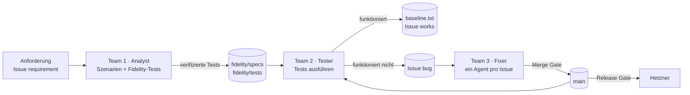

# AGENTS.md – Arbeitsweise in AI Perspectives

Repository: [MarvinJakob/AIPerspectives](https://github.com/MarvinJakob/AIPerspectives) · Projekt: **AI Perspectives** (GitHub Projects, Besitzer `MarvinJakob`) · Aufbau der Anwendung und Umgebung: [ARCHITECTURE.md](ARCHITECTURE.md)

Mehrere Agenten arbeiten gleichzeitig auf diesem Gerät. Sie sind in drei Teams getrennt und stimmen sich **nicht** miteinander ab. Die Übergabe zwischen den Teams läuft ausschließlich über das Repository (Fidelity-Tests, Baseline) und GitHub-Issues (Labels). Jeder Agent bearbeitet genau eine Aufgabe, schließt sie ab und nimmt erst dann die nächste.



## Auftrag

**Einheitlicher Start:** Vor `work` den aktuellen Prozess laden: `bash tools/work.sh --check`. Aus einem alten Checkout ohne diesen Befehl: `git fetch origin main` und `git show origin/main:tools/work.sh | bash -s -- --check`. Der Bootstrap verwendet einen unveränderlichen, separaten Checkout von `origin/main`, nennt dessen Commit und prüft Werkzeuge, GitHub und Board. Alte Arbeitskopien und ihre ungesicherten Änderungen bleiben unverändert. Alle Aufgaben-Skripte aus diesem Prozessstand verwenden; Änderungen weiterhin ausschließlich im eigenen Aufgaben-Worktree.

Der Auftrag im Chat nennt das Team, optional mit Issue: `Team 1`, `Team 2`, `Team 3`, `Team 3 #45`. Ohne Issue prüft der Agent zuerst die offenen Board-Tickets in `Review`, `In Progress` und `Ready` (siehe „Auswahl und Wiederaufnahme“), dann den Backlog seines Teams. Gibt es keine freie passende Aufgabe, meldet er das und endet. Eine spätere automatische Aktivierung braucht eine separate Betriebssteuerung.

**Auftrag `work`:** Der Agent ordnet sich selbst einem Team zu. Die Stufen bestimmen das Team (frei heißt: ohne `in-progress` und `blocked`):

1. Team 3: freies `release-blocker`-Issue.
2. Team 1: freies `test-defect`-Issue.
3. Team 2: freie Anforderung mit `specified`, die nach Schritt 2 von Team 2 zu bearbeiten ist.
4. Team 3: freies `bug`-Issue.
5. Team 1: freie Anforderung mit `needs-analysis`.

Nach Release-Blockern und vor neuem fachlichem Backlog übernimmt `work` auch Wartung mit **beiden** Labels `maintenance` und `maintenance-approved` als `maint`. `maintenance-approved` setzt der Maintainer für einen ausdrücklichen, im Issue dokumentierten Auftrag. Die Release-Nacharbeit darf dieses Label im eng beschriebenen Umfang ihres automatisch angelegten Tickets setzen. Neue Berechtigungen, fachliche Entscheidungen und nicht autorisierte Infrastrukturänderungen bleiben Rückfragen. `waiting-for-test` wird bei der Auswahl ebenso ausgeschlossen wie `blocked`.

Reihenfolge: zuerst Stufe 1, dann „Auswahl und Wiederaufnahme“ einschließlich freigegebener Wartung (Board-Tickets in `Review`, dann `In Progress`, dann `Ready`), dann der Backlog. Bei gleicher Priorität das älteste Issue. Bei `Review` und `In Progress` ergibt sich das Team aus der dokumentierten Übergabe bzw. dem Branch-Präfix (`spec/`, `verify/`, `fix/`, `codex/maint-`), sonst aus den Labels. Wartung ohne `maintenance-approved` übernimmt `work` nicht.

Liefert `tools/task.sh claim` bzw. `resume` Exitcode `2`, versucht er die nächste Aufgabe derselben Stufe, dann die nächste Stufe. Jeder andere Fehler (z. B. Exitcode `1`, Boardzugriff) zählt nicht als „belegt“: melden und enden. Er nennt im Chat das gewählte Team und das Issue und arbeitet danach genau wie ein Agent dieses Teams. Nach `finish` oder `pause` wählt er die nächste Aufgabe erneut nach Auftrag `work`; Tickets, an denen er selbst implementiert hat, reviewt er nicht. Gibt es nirgends eine freie Aufgabe, meldet er das und endet.

## Gemeinsame Regeln

1. **Zugang:** GitHub über die Umgebungsvariable `GH_TOKEN` (für `gh` und `git`), Hetzner Cloud über `HCLOUD_TOKEN`. Werte nie ausgeben, in Dateien schreiben oder committen. Fehlt eine Variable im Prozess, steht sie in den Windows-Benutzervariablen; das Terminal bzw. den Agenten dann neu starten.
2. **Eine Aufgabe, ein Worktree.** Vor jeder Änderung die Aufgabe belegen:
   ```bash
   bash tools/task.sh claim <spec|verify|fix> <Issue-Nummer>
   ```
   `AGENT_ID` ist eine eindeutige Sitzungs-ID; bei Codex wird `CODEX_THREAD_ID` automatisch verwendet. Andere Agenten setzen sie einmal pro Sitzung. Exitcode `2` heißt: belegt bzw. nicht zur Übernahme freigegeben, nächste Aufgabe wählen. Eine freigegebene Aufgabe übernimmt man mit `bash tools/task.sh resume <spec|verify|fix> <n>` im vorhandenen Worktree. **Alle Änderungen, Builds und Commits nur dort.** Im Hauptverzeichnis weder Branch wechseln noch committen.
3. **Übergabe ausschließlich im Repository.** Keine direkten Nachrichten zwischen Teams. Aktive fremde Aufgaben nie übernehmen. Nach dokumentierter Freigabe darf ein anderer Agent den vorhandenen Branch fortsetzen oder reviewen; Fragen, Antworten, Zwischenstand und Review stehen am Issue bzw. PR.
4. **Team-Grenzen** (das Merge Gate erzwingt sie über den Branch-Präfix):

   | Team | Branch | darf ändern | darf nicht ändern |
   |---|---|---|---|
   | 1 Analyst | `spec/<n>` | `fidelity/specs/`, `fidelity/tests/` | Anwendungscode, Baseline |
   | 2 Tester | `verify/<n>` | `fidelity/baseline.txt` (nur anhängen) | Tests, Anwendungscode |
   | 3 Fixer | `fix/<n>` | `app/`, `fidelity/baseline.txt` (nur anhängen) | `fidelity/specs`, `fidelity/tests`, `fidelity/scripts`, `.github/`, `AGENTS.md` |

   Prozess- und Infrastrukturdateien (`AGENTS.md`, `ARCHITECTURE.md`, `.github/`, `tools/`) ändert nur der Maintainer bzw. ein ausdrücklicher Auftrag.
   Solche Wartungsaufträge werden mit `bash tools/task.sh claim maint <n>` belegt: Branch `codex/maint-<n>`, Worktree `.worktrees/maint-<n>`. Für `pause`, `resume` und `finish` ebenfalls `maint` verwenden. Dies ist kein viertes Team; unabhängiges Review und Merge Gate gelten unverändert.
5. **Abschluss:** PR erst öffnen, wenn die lokalen Prüfungen bestehen; vor unabhängiger Abnahme als Draft. Mergen nur mit grünem **Merge Gate** (`gh pr checks <PR> --watch`, dann `gh pr merge <PR> --squash --delete-branch`). Nie `--admin`, nie Checks umgehen. Danach `bash tools/task.sh finish <team> <n>`.
6. **Blocker:** Ist eine Aufgabe ohne Rückfrage nicht lösbar, die konkrete Frage, den Entscheidungsbedarf und den bisherigen Stand ins Issue kommentieren, Label `blocked` setzen und Board-Status `Blocked` wählen: `bash tools/board.sh block <n> <Fragen-Datei>`. Vorhandene Änderungen als Zwischenstand committen und die Übergabe mit Team, Branch, Commit, beteiligten Implementierer-IDs und nächstem Schritt im Issue dokumentieren. Danach `bash tools/task.sh pause <team> <n>`; Server beenden, nächste Aufgabe. **Kein `finish --abandon`: Branch und Worktree bleiben erhalten.** Der Maintainer beantwortet die Frage im Kommentar und verschiebt nach `In Progress`. Ein freier Agent liest die Antworten, entfernt `blocked` mit `bash tools/board.sh unblock <n>` und übernimmt mit `resume`. Fehlt die erforderliche Antwort, die konkrete noch offene Frage kommentieren und wieder nach `Blocked` verschieben. Nicht raten.
7. **Sparsam arbeiten:** Nur lesen, was die Aufgabe braucht: dieses Dokument, das Issue, die Spezifikation `fidelity/specs/REQ-<n>.md` und den betroffenen Code. `content/`, `res/` und `mock/` sind nur dann Vorgaben, wenn der Auftrag sie ausdrücklich als fachliche Quelle nennt; `content/archive/` ist veraltet und wird nie gelesen. Issue-Kommentare kurz und sachlich.
8. **Commits:** [Conventional Commits](https://www.conventionalcommits.org/de/v1.0.0/) mit Issue-Nummer, z. B. `fix: Themenseite liefert 404 für Entwürfe (#45)`. Vor dem Push `git fetch origin && git rebase origin/main`, danach betroffene Prüfungen wiederholen.
9. **Parallele Server:** Jeder Agent startet die Anwendung auf eigenem Port `20000 + <Issue-Nummer>` und mit eigener Datenbank im Worktree (siehe [Befehle](#befehle)).
10. **Lebenszeichen und Wiederherstellung:** Während einer Belegung regelmäßig `bash tools/task.sh heartbeat <team> <n>` ausführen. `task.sh status` zeigt Besitzer, letztes Lebenszeichen und Operationssperren. Ein altes Lebenszeichen allein erlaubt niemals eine Übernahme. Nach nachgewiesenem Abbruch genehmigt der Maintainer am Issue `Recover-Task: <team>/<n>`, `Owner: <bisherige ID>` und `Operation-Lock: <aktueller Objektwert oder none>` auf getrennten Zeilen. `node tools/recover-task.mjs <team> <n> <Kommentar-ID>` prüft Autor, Issue, Besitzer und Lebenszeichen, bewahrt Dateien und gibt zur Wiederaufnahme frei. Legacy-Aufgaben ohne Besitzerdaten werden nicht automatisch migriert.

## Labels und Board

Labels bestimmen das zuständige Team. Das Board bestimmt zusätzlich den Bearbeitungsschritt: `bash tools/board.sh list` bzw. `bash tools/board.sh <n> "<Status>"`. Ein fehlgeschlagener Boardzugriff ist kein Nachweis einer leeren Warteschlange; Fehler melden und keine aktive Belegung übergehen. `In Arbeit` wird als bisheriger Name von `In Progress`, `Merge Gate` als bisheriger Name von `Review` unterstützt.

| Label | Bedeutung | Board-Status |
|---|---|---|
| `requirement` + `needs-analysis` | Anforderung, noch ohne Fidelity-Tests → Team 1 | Neu |
| `requirement` + `specified` | Fidelity-Tests liegen auf `main` → Team 2 | Spezifiziert |
| `requirement` + `done` | alle Akzeptanzkriterien in der Baseline, Issue geschlossen | Funktioniert |
| `bug` | Fidelity-Test schlägt fehl → Team 3 | Bug offen |
| `works` | Nachweis funktionierender Kriterien (sofort geschlossen) | Funktioniert |
| `test-defect` | Test selbst ist falsch oder instabil → Team 1 | Neu |
| `release-blocker` | Regression einer Baseline-ID, sperrt das Release → Team 3 zuerst | Bug offen |
| `in-progress` | aktuell von einem Agenten belegt (setzt `tools/task.sh`) | In Progress oder Review |
| `blocked` | wartet auf eine Antwort des Maintainers | Blocked |
| `waiting-for-test` | wartet auf separat beauftragte Testkorrektur | In Progress |
| `maintenance` + `maintenance-approved` | ausdrücklich autorisierte Infrastrukturarbeit → maint | Ready / Review |
| `release-failure` | Nacharbeit eines fehlgeschlagenen Produktionsrelease | Ready / Blocked |

PRs vor Abnahme: Board-Status `Review`. Nach Abnahme bleibt das Ticket dort bis zum grünen Merge Gate und Merge.

### Auswahl und Wiederaufnahme

Vor jeder neuen Aufgabe `bash tools/board.sh list` sowie die aktuellen Issue-Kommentare und gegebenenfalls den PR lesen. Die Repository-URL beachten: gleiche Issue-Nummern aus anderen Repositories sind andere Aufgaben. Innerhalb des eigenen Teams zuerst Regressionen (`release-blocker`), dann folgende Schritte bearbeiten:

1. **Review:** Ein zur Prüfung freigegebener PR kann von einer anderen Agentensitzung übernommen werden. Kein Agent, der Änderungen für dieses Ticket implementiert hat, darf dessen Review übernehmen, auch nicht nach einer Pause. Alle Implementierer-IDs stehen im PR (`Implementer-Agents:`). Der Reviewer liest Issue, Spezifikation und Diff ohne Umsetzungskontext. Aktuellen Head-Commit, Reviewer-ID, Ergebnis und Befunde als PR-Kommentar dokumentieren. `Reviewer-Agent:` und `Reviewed-Commit:` im PR-Text müssen zum Nachweis passen. Nach jeder weiteren Codeänderung ist ein neues unabhängiges Review des neuen Commits nötig. Befunde an einen Implementierer übergeben, nicht im eigenen Review selbst implementieren und anschließend abnehmen.
2. **In Progress:** Antworten auf frühere Blocker und dokumentierte Übergaben prüfen. Nur mit `pause` freigegebene Aufgaben mit `resume` fortsetzen. Ein Boardstatus allein hebt keine aktive Sperre auf. Bei alten Worktrees ohne Freigabe erst einen belegbaren Übergabe-/Wiederherstellungsentscheid des Maintainers einholen; niemals einen vermuteten Absturz als Erlaubnis zum Übernehmen verwenden.
3. **Ready:** Die nächste passende freie Aufgabe nach Teamregeln mit `claim` belegen, danach Boardstatus `In Progress` setzen. Besteht bereits ein freigegebener Zwischenstand, `resume` verwenden.
4. **Backlog:** Weitere Aufgaben nach den unten beschriebenen Teamregeln wählen. `Blocked` wird nur auf neue Antworten geprüft, nicht ohne Klärung implementiert. Die Rückkehr nach `In Progress` durch den Maintainer erlaubt, das noch vorhandene `blocked`-Label nach Lesen der Antwort zu entfernen.

Für eine Übergabe alle Änderungen committen, den Branch pushen und im Issue/PR Team, Branch, Commit, Implementierer-IDs, Prüfergebnisse und nächsten Schritt festhalten; dann `pause` ausführen. `in-progress` bezeichnet aktive Belegung und wird dabei entfernt. Der Boardstatus `In Progress` bzw. `Review` bleibt als Warteschlange bestehen. Bei Review-Übergabe ist die Implementierung abgeschlossen; der Implementierer nimmt stattdessen eine andere Aufgabe. Reviewer sind eine Rolle innerhalb der drei Teams, kein viertes Team.

**Review-Nachweis:** Der unabhängige Reviewer führt nach Prüfung des exakten Commits `node tools/review.mjs <PR> <SHA> <Bericht-Datei>` in seiner eigenen Sitzung aus. Das Werkzeug erstellt ein GitHub-Review mit Sitzungs-ID, Commit und Ergebnis und ergänzt dessen `Review-ID` im PR. Das Gate prüft den gespeicherten Review-Datensatz, Repository-Berechtigung, Sitzung und Commit. Nach Codeänderungen ist ein neuer Nachweis erforderlich. Gemeinsame GitHub-Zugänge beweisen keine kryptographische Trennung der Agentensitzungen; Sitzungs-IDs müssen wahrheitsgemäß sein. Für eine stärkere Identitätsgrenze sind getrennte Reviewer-Zugänge erforderlich.

**Abschlussabgleich:** `node tools/reconcile.mjs` zeigt notwendige Korrekturen; `--apply --board` führt sie wiederholbar aus. Der Workflow „Prozessabgleich“ gleicht Labels und erledigte Anforderungen nach Push, Issue-Abschluss und stündlich ab. Er arbeitet ausschließlich mit auf `main` eingecheckten Spezifikationen und Baseline-IDs. Offene Folge-PRs schützen laufende Arbeit. Fremde lokale Branches, Worktrees und Besitzersperren werden nie entfernt. Der Eigentümer führt weiterhin `finish` aus. Board-Abgleich läuft über den lokalen Worker oder optional ein separat berechtigtes Actions-Secret `PROCESS_BOARD_TOKEN`.

Ein unterbrochener `finish` hinterlässt `finishing-head` und kann wiederholt werden. Nach ausdrücklicher Recovery-Freigabe darf eine neue Sitzung mit `resume` auch diesen Abschluss ohne vorhandenen Worktree übernehmen; die Ausgabe weist dann ausschließlich auf `finish` hin. In diesem Zustand keine weitere Implementierung beginnen.

**Betriebssteuerung:** `bash tools/work.sh --once` startet eine frische Worker-Sitzung für genau eine Aufgabe; `--watch` reagiert auf neue Issues, Antworten, PRs und Fidelity-Ergebnisse. Unter Windows startet `tools/work-watch.ps1` bei einem neuen `main`-Stand den Bootstrap erneut. Standard ist `codex exec --approve-for-me`; keine Sandbox-/Approval-Umgehung. Andere Clients lassen sich mit `WORK_AGENT_COMMAND` und `WORK_AGENT_ARGS` (JSON-Array) konfigurieren. Es läuft höchstens ein Supervisor pro gemeinsamem Repository, echte Fehler stoppen ihn. Kein automatisches Übernehmen aktiver oder verwaister Aufgaben. `Ctrl+C` lässt den aktiven Worker seine Übergabe abschließen. Eine weitere Reviewer-Sitzung übernimmt die nächste freigegebene Prüfung.

## Team 1 – Analyst

Ziel: Für jede Anforderung Akzeptanzkriterien und Fidelity-Tests, die zuverlässig zeigen, ob die Anforderung **vollständig** umgesetzt ist.

1. **Auswählen:** zuerst `test-defect`, dann die älteste Anforderung:
   ```bash
   gh issue list -l test-defect --search "-label:in-progress -label:blocked sort:created-asc"
   gh issue list -l requirement -l needs-analysis --search "-label:in-progress -label:blocked sort:created-asc"
   ```
   Belegen: `bash tools/task.sh claim spec <n>`.
2. **Analysieren:** Issue lesen. Jede fachliche Aussage wird ein Akzeptanzkriterium oder steht ausdrücklich unter „Nicht Teil der Anforderung“. Widersprüche oder fehlende Entscheidungen → Blocker (Regel 6).
3. **Spezifizieren:** `fidelity/specs/REQ-<n>.md` nach [fidelity/specs/_VORLAGE.md](fidelity/specs/_VORLAGE.md). IDs `REQ-<n>-AC<m>`, fortlaufend, nie wiederverwendet. Kriterien SMART und von außen beobachtbar (sichtbarer Text, URL, Statuscode, API-Antwort).
4. **Tests schreiben:** `fidelity/tests/REQ-<n>.spec.ts`, genau ein Playwright-Test pro Kriterium, Titel beginnt mit der ID. Nur über Browser oder HTTP prüfen, Elemente über Rolle und sichtbaren Text finden (`getByRole`, `getByText`), keine CSS-Klassen oder internen Aufrufe. Testdaten nur aus `DEV_SEED` oder im Test angelegt. Tests unabhängig voneinander, Desktop und Mobil.
5. **Verifizieren** (Pflicht, Ergebnis in der Checkliste der Spezifikation): App aus `origin/main` lokal starten, Tests ausführen.
   - Bestandener Test: Gegenprobe – Erwartung kurz verfälschen, Test muss rot werden, Änderung zurücknehmen.
   - Fehlgeschlagener Test: Er muss aus dem richtigen Grund scheitern (Funktion fehlt), nicht wegen Tippfehler, falschem Selektor oder Zeitüberschreitung.
   - Vollständigkeit: Jede Aussage des Issues ist durch ein Kriterium abgedeckt.
   Danach `status: verifiziert` und Datum in der Spezifikation.
6. **Übergeben:** PR `spec/<n>` mit `Refs #<n>` (nicht `Closes`), unabhängiges Review nach „Auswahl und Wiederaufnahme“, Merge Gate abwarten, mergen. Labels `needs-analysis` → `specified`, Board „Spezifiziert“. Bei `test-defect`: Test korrigieren, Issue schließen. `tools/task.sh finish`.

Team 1 ändert nie Anwendungscode und nie die Baseline. Ein ersetztes Kriterium bekommt eine neue ID; die alte ID entfernt nur der Maintainer aus der Baseline.

## Team 2 – Tester

Ziel: Feststellen, was funktioniert und was nicht, und dafür Tickets anlegen. Team 2 nutzt ausschließlich die Fidelity-Tests von Team 1.

1. **Testlauf holen:** Der Workflow „Fidelity-Lauf“ testet `main` nach jedem Push. Neuesten abgeschlossenen Lauf laden und auswerten:
   ```bash
   gh run list -w fidelity-run.yml -b main --status completed -L 1 --json databaseId,headSha,status,conclusion
   gh run download <databaseId> -n fidelity-main -D .worktrees/fidelity-<databaseId>
   node fidelity/scripts/gate.mjs --results .worktrees/fidelity-<databaseId>/results.json --inventory .worktrees/fidelity-<databaseId>/inventory.json
   ```
   Nur vollständige Berichte samt Inventar auswerten. Globale Fehler, fehlende Projekte oder übersprungene Tests sind ein defekter Testlauf und kein fachliches Bug-Ticket. `headSha` im Nachweis festhalten; nur Kriterien bewerten, die in diesem Commit bereits enthalten waren. Fehlen aktuelle Kriterien, den nächsten abgeschlossenen Lauf nehmen. Nur bei Bedarf selbst einen starten (`gh workflow run fidelity-run.yml`).
2. **Arbeit bestimmen:** Eine Anforderung `REQ-<n>` ist zu bearbeiten, wenn sie (a) neu funktionierende IDs hat, (b) fehlschlagende IDs ohne offenes Bug-Issue (`gh issue list -l bug --search "REQ-<n>-AC in:title"`), (c) Regressionen oder (d) alle IDs in der Baseline hat, aber noch offen ist. Belegen: `bash tools/task.sh claim verify <n>`, sonst nächste Anforderung.
3. **Funktioniert nicht:** Pro Fehlerursache ein Issue nach [bug.yml](.github/ISSUE_TEMPLATE/bug.yml): Titel `[REQ-<n>-AC<m>] …`, alle betroffenen IDs, erwartetes und tatsächliches Verhalten, Link zum Lauf. Label `bug`, Board „Bug offen“. Regression einer Baseline-ID zusätzlich `release-blocker`. Wirkt der Test selbst falsch oder instabil: Label `test-defect` statt `bug`.
4. **Funktioniert:** Neu bestandene IDs im Worktree an `fidelity/baseline.txt` anhängen, PR `verify/<n>` (das Merge Gate prüft, dass sie bestehen), mergen. Ein Issue nach [funktioniert.yml](.github/ISSUE_TEMPLATE/funktioniert.yml) mit Label `works` anlegen und sofort schließen (`gh issue close <nr> --reason completed`).
5. **Anforderung erfüllt:** Stehen alle IDs der Spezifikation in der Baseline: Label `done`, Anforderung schließen, Board „Funktioniert“. `tools/task.sh finish`.

Team 2 ändert nie Tests oder Anwendungscode und behebt keine Fehler.

## Team 3 – Fixer

Ziel: Genau ein Bug-Issue pro Agent beheben. Code kommt nur über das Merge Gate nach `main`.

1. **Auswählen:** zuerst `release-blocker`, dann das älteste Bug-Issue:
   ```bash
   gh issue list -l bug --search "-label:in-progress -label:blocked sort:created-asc"
   ```
   Belegen: `bash tools/task.sh claim fix <n>`.
2. **Reproduzieren:** Issue, Spezifikation und Test lesen. App im Worktree starten, `npx playwright test --grep "<ID>"` muss rot sein. Ist es grün: Kommentar mit Commit ins Issue, schließen, `finish`.
3. **Beheben:** Nur in `app/`, so klein wie möglich, nach den Konventionen in [app/README.md](app/README.md). Schnittstellenänderungen beginnen in `app/api/openapi.yaml`, Migrationen nur additiv. Geänderte Logik bekommt Unit-Tests. Tests und Spezifikationen von Team 1 werden nie angepasst. Passt ein Test nicht zur Anforderung: `node tools/test-defect.mjs <Bug-Issue> <Befund-Datei>` legt ein separates, freies `test-defect`-Issue an und verknüpft es. Das Bug-Issue erhält `waiting-for-test`, nicht allein deswegen `blocked`. Eigenen Zwischenstand sichern und `pause`. Nach abgeschlossenen Testkorrekturen entfernt der Abgleich `waiting-for-test`; echte zusätzliche Maintainer-Blocker bleiben erhalten.
4. **Lokal prüfen:** relevante Unit-Tests, die IDs des Issues grün, ganze Fidelity-Suite ohne Regression:
   ```bash
   cd fidelity && npm test; npm run gate -- --require "REQ-<n>-AC<m>"
   ```
5. **Review vorbereiten:** Alle Implementierer-Sitzungs-IDs festhalten. Nach Übergabe prüft eine andere, unbeteiligte Agentensitzung Diff, Issue und Spezifikation auf Korrektheit, Sicherheit und Wartbarkeit. Ein Implementierer darf sein Ticket nicht selbst reviewen. Befunde beheben oder im PR begründen und den geänderten Commit erneut unabhängig prüfen lassen.
6. **PR:** Behobene IDs an `fidelity/baseline.txt` anhängen. Rebase auf `origin/main`, betroffene Prüfungen wiederholen, Push. Draft-PR nach [Vorlage](.github/pull_request_template.md) mit `Closes #<n>` und `Fidelity: <IDs>` öffnen, Implementierer-IDs eintragen; Review-Punkt erst nach tatsächlicher unabhängiger Prüfung abhaken. Board „Review“, Übergabe dokumentieren und `pause`. Der Reviewer trägt seinen Nachweis ein, vervollständigt die Checkliste und markiert den PR als bereit (`gh pr ready <PR>`). Änderungen am PR-Text lösen das Gate ebenfalls erneut aus.
7. **Merge Gate:** Rot → im selben Branch beheben und pushen. Grün → mergen, `tools/task.sh finish fix <n>`.

## Merge Gate

Workflow [merge-gate.yml](.github/workflows/merge-gate.yml), Pflichtprüfung „Merge Gate“ für jeden PR nach `main`:

| Prüfung | besteht, wenn |
|---|---|
| Team-Grenzen | der Branch nur die erlaubten Dateien ändert und keine Baseline-ID entfernt |
| Build | das Produktions-Image (beide Frontends, Backend) baut |
| Unit-Tests | `go vet`, `go test` (mit Race-Detector für Parallelitätstests), Typprüfung und Tests beider Frontends grün |
| Security | `govulncheck`, `npm audit --audit-level=high`, Dependency Review und Secret-Scan ohne Befund |
| Review | die Checkliste im PR-Text vollständig abgehakt ist, inklusive unabhängigem Review |
| Fidelity | alle Baseline-IDs bestehen und alle im PR geforderten bzw. neu in die Baseline aufgenommenen IDs bestehen |

`main` muss auf GitHub durch eine Branch-Regel geschützt sein: Pull Requests und Statusprüfung `Merge Gate` erforderlich, Branch vor Merge aktuell, Regeln auch für Administratoren, kein Force-Push und keine Branch-Löschung. Ein vorhandener Workflow allein verhindert keinen ungeprüften Merge.

Die Fidelity-Suite wird vollständig auf Desktop und Mobil ausgeführt und mit einem vorab erzeugten Testinventar abgeglichen. Globale Fehler, leere oder unvollständige Läufe, Skip und erwartete Fehlschläge sperren das Gate. Instabile Tests gelten nicht als funktionierend. Nur regulär bestandene IDs können Baseline oder Erfolgsnachweis werden; bekannte fachliche Fehlschläge außerhalb der Baseline bleiben Backlog.

## Release Gate

Workflow [release.yml](.github/workflows/release.yml) startet nach Push/Merge auf `main`. Ablauf: ein Image bauen → Unit- und Fidelity-Tests gegen dessen Image-ID → Final Check (Commit aus `main`, keine `release-blocker`, Fast-Forward) → GitHub-SSH-Zugang prüfen → verpflichtender Hetzner-Snapshot → exakt dieses Image übertragen und Image-ID/Commit prüfen → Produktions-Smoke → Branch `release` → wiederholbar Tag und Release veröffentlichen. Hetzner baut kein zweites Image. Version und Tag enthalten Commit- und Image-ID-Anteile. Ein vorhandener Release-Branch allein überspringt weder Deployment noch Veröffentlichung.

GitHub Actions verwendet ausschließlich `HETZNER_CLOUD_SSH`, `HETZNER_CLOUD_API`, `DEPLOY_HOST` und `DEPLOY_KNOWN_HOSTS` aus `production`; Werte werden nie ausgelesen oder lokal kopiert. `gh workflow run deploy-access.yml` prüft API, Serverzuordnung und SSH ohne Deployment. Fehlende Snapshot-Konfiguration sperrt das Release. Bei Deployment- oder Produktions-Smoke-Fehler wird die vorherige Version wieder aktiviert und geprüft; bei einer Erstinstallation ohne Vorgänger ist explizite Wiederherstellung nötig. Manuell: `gh workflow run release.yml -f ref=main`. Rollback: [rollback.yml](.github/workflows/rollback.yml). Ein fehlgeschlagener Release erzeugt deduplizierte, für `work` autorisierte Nacharbeit; Zugangsklärungen werden blockiert, nicht wiederholt geraten. Details: [ARCHITECTURE.md](ARCHITECTURE.md#7-auslieferung).

## Befehle

Im eigenen Worktree, Port `P = 20000 + <Issue-Nummer>` (Git Bash):

```bash
# Anwendung bauen und mit Testdaten starten (Testkonten: app/backend/migrations/dev/00002_dev_accounts.sql)
(cd app/frontend && npm ci && npm run build) && (cd app/frontend-redaktion && npm ci && npm run build)
(cd app/backend && CGO_ENABLED=0 go build -o ../.build/server ./cmd/server)
(cd app && DEV_SEED=true SERVE_MEDIA=true ADDR=127.0.0.1:$P PUBLIC_BASE_URL=http://localhost:$P DATABASE_PATH=.build/dev.db MEDIA_PATH=.build/media ./.build/server &)

# Fidelity-Tests (einmalig: npm ci && npx playwright install chromium)
cd fidelity && BASE_URL=http://localhost:$P npx playwright test --grep "REQ-12-"
BASE_URL=http://localhost:$P npm test && npm run gate

# Unit-Tests wie im Merge Gate
(cd app/backend && go vet ./... && go test ./...)
(cd app/frontend && npm run typecheck && npm test) && (cd app/frontend-redaktion && npm run typecheck && npm test)
```

Server nach der Arbeit beenden. Code-Erzeugung nach Änderungen an `openapi.yaml` oder SQL: siehe [app/README.md](app/README.md).
