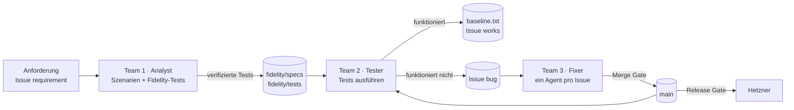

# AGENTS.md – Arbeitsweise in AI Perspectives

Repository: [MarvinJakob/AIPerspectives](https://github.com/MarvinJakob/AIPerspectives) · Projekt: **AI Perspectives** (GitHub Projects, Besitzer `MarvinJakob`) · Aufbau der Anwendung und Umgebung: [ARCHITECTURE.md](ARCHITECTURE.md)

Mehrere Agenten arbeiten gleichzeitig auf diesem Gerät. Sie sind in drei Teams getrennt und stimmen sich **nicht** miteinander ab. Die Übergabe zwischen den Teams läuft ausschließlich über das Repository (Fidelity-Tests, Baseline) und GitHub-Issues (Labels). Jeder Agent bearbeitet genau eine Aufgabe, schließt sie ab und nimmt erst dann die nächste.



## Auftrag

Der Auftrag im Chat nennt das Team, optional mit Issue: `Team 1`, `Team 2`, `Team 3`, `Team 3 #45`. Ohne Issue wählt der Agent die nächste freie Aufgabe nach dem Ablauf seines Teams. Gibt es keine freie Aufgabe, meldet er das und endet.

## Gemeinsame Regeln

1. **Zugang:** GitHub über die Umgebungsvariable `GH_TOKEN` (für `gh` und `git`), Hetzner Cloud über `HCLOUD_TOKEN`. Werte nie ausgeben, in Dateien schreiben oder committen. Fehlt eine Variable im Prozess, steht sie in den Windows-Benutzervariablen; das Terminal bzw. den Agenten dann neu starten.
2. **Eine Aufgabe, ein Worktree.** Vor jeder Änderung die Aufgabe belegen:
   ```bash
   bash tools/task.sh claim <spec|verify|fix> <Issue-Nummer>
   ```
   Exitcode `2` heißt: Ein anderer Agent hat sie, nächste Aufgabe wählen. Bei Erfolg steht der Pfad des Worktrees in der letzten Zeile. **Alle Änderungen, Builds und Commits nur dort.** Im Hauptverzeichnis weder Branch wechseln noch committen.
3. **Keine Abstimmung zwischen Agenten.** Nicht auf andere Agenten warten, keine Nachrichten an sie, keine Arbeit an fremden Branches. Was ein anderes Team braucht, steht als Issue mit Label im Repository.
4. **Team-Grenzen** (das Merge Gate erzwingt sie über den Branch-Präfix):

   | Team | Branch | darf ändern | darf nicht ändern |
   |---|---|---|---|
   | 1 Analyst | `spec/<n>` | `fidelity/specs/`, `fidelity/tests/` | Anwendungscode, Baseline |
   | 2 Tester | `verify/<n>` | `fidelity/baseline.txt` (nur anhängen) | Tests, Anwendungscode |
   | 3 Fixer | `fix/<n>` | `app/`, `fidelity/baseline.txt` (nur anhängen) | `fidelity/specs`, `fidelity/tests`, `fidelity/scripts`, `.github/`, `AGENTS.md` |

   Prozess- und Infrastrukturdateien (`AGENTS.md`, `ARCHITECTURE.md`, `.github/`, `tools/`) ändert nur der Maintainer bzw. ein ausdrücklicher Auftrag.
5. **Abschluss:** PR erst öffnen, wenn lokal alles grün ist. Mergen nur mit grünem **Merge Gate** (`gh pr checks <PR> --watch`, dann `gh pr merge <PR> --squash --delete-branch`). Nie `--admin`, nie Checks umgehen. Danach `bash tools/task.sh finish <team> <n>`.
6. **Blocker:** Ist eine Aufgabe ohne Rückfrage nicht lösbar, einen kurzen Kommentar mit der konkreten Frage ins Issue, Label `blocked` setzen, `bash tools/task.sh finish <team> <n> --abandon`, nächste Aufgabe. Nicht raten.
7. **Sparsam arbeiten:** Nur lesen, was die Aufgabe braucht: dieses Dokument, das Issue, die Spezifikation `fidelity/specs/REQ-<n>.md` und den betroffenen Code. `content/` (außer als fachliche Quelle einer Anforderung), `res/` und `mock/` sind keine Vorgaben; `content/archive/` ist veraltet und wird nie gelesen. Issue-Kommentare kurz und sachlich.
8. **Commits:** [Conventional Commits](https://www.conventionalcommits.org/de/v1.0.0/) mit Issue-Nummer, z. B. `fix: Themenseite liefert 404 für Entwürfe (#45)`. Vor dem Push `git fetch origin && git rebase origin/main`, danach betroffene Prüfungen wiederholen.
9. **Parallele Server:** Jeder Agent startet die Anwendung auf eigenem Port `20000 + <Issue-Nummer>` und mit eigener Datenbank im Worktree (siehe [Befehle](#befehle)).

## Labels und Board

Labels sind maßgeblich für die Auswahl von Aufgaben. Das Board „AI Perspectives“ spiegelt den Stand für Menschen (`bash tools/board.sh <n> "<Status>"`; schlägt das fehl, weiterarbeiten).

| Label | Bedeutung | Board-Status |
|---|---|---|
| `requirement` + `needs-analysis` | Anforderung, noch ohne Fidelity-Tests → Team 1 | Neu |
| `requirement` + `specified` | Fidelity-Tests liegen auf `main` → Team 2 | Spezifiziert |
| `requirement` + `done` | alle Akzeptanzkriterien in der Baseline, Issue geschlossen | Funktioniert |
| `bug` | Fidelity-Test schlägt fehl → Team 3 | Bug offen |
| `works` | Nachweis funktionierender Kriterien (sofort geschlossen) | Funktioniert |
| `test-defect` | Test selbst ist falsch oder instabil → Team 1 | Neu |
| `release-blocker` | Regression einer Baseline-ID, sperrt das Release → Team 3 zuerst | Bug offen |
| `in-progress` | von einem Agenten belegt (setzt `tools/task.sh`) | In Arbeit |
| `blocked` | wartet auf eine Antwort des Maintainers | – |

Offene PRs: Board-Status `Merge Gate`.

## Team 1 – Analyst

Ziel: Für jede Anforderung Akzeptanzkriterien und Fidelity-Tests, die zuverlässig zeigen, ob die Anforderung **vollständig** umgesetzt ist.

1. **Auswählen:** zuerst `test-defect`, dann die älteste Anforderung:
   ```bash
   gh issue list -l test-defect --search "-label:in-progress -label:blocked sort:created-asc"
   gh issue list -l requirement -l needs-analysis --search "-label:in-progress -label:blocked sort:created-asc"
   ```
   Belegen: `bash tools/task.sh claim spec <n>`.
2. **Analysieren:** Issue lesen. Jede fachliche Aussage wird ein Akzeptanzkriterium oder steht ausdrücklich unter „Nicht Teil der Anforderung“. Widersprüche oder fehlende Entscheidungen → Blocker (Regel 6).
3. **Spezifizieren:** `fidelity/specs/REQ-<n>.md` nach [fidelity/specs/_VORLAGE.md](fidelity/specs/_VORLAGE.md). IDs `REQ-<n>-AC<m>`, fortlaufend, nie wiederverwendet. Kriterien SMART und von außen beobachtbar (sichtbarer Text, URL, Statuscode, API-Antwort).
4. **Tests schreiben:** `fidelity/tests/REQ-<n>.spec.ts`, genau ein Playwright-Test pro Kriterium, Titel beginnt mit der ID. Nur über Browser oder HTTP prüfen, Elemente über Rolle und sichtbaren Text finden (`getByRole`, `getByText`), keine CSS-Klassen oder internen Aufrufe. Testdaten nur aus `DEV_SEED` oder im Test angelegt. Tests unabhängig voneinander, Desktop und Mobil.
5. **Verifizieren** (Pflicht, Ergebnis in der Checkliste der Spezifikation): App aus `origin/main` lokal starten, Tests ausführen.
   - Bestandener Test: Gegenprobe – Erwartung kurz verfälschen, Test muss rot werden, Änderung zurücknehmen.
   - Fehlgeschlagener Test: Er muss aus dem richtigen Grund scheitern (Funktion fehlt), nicht wegen Tippfehler, falschem Selektor oder Zeitüberschreitung.
   - Vollständigkeit: Jede Aussage des Issues ist durch ein Kriterium abgedeckt.
   Danach `status: verifiziert` und Datum in der Spezifikation.
6. **Übergeben:** PR `spec/<n>` mit `Refs #<n>` (nicht `Closes`), Merge Gate abwarten, mergen. Labels `needs-analysis` → `specified`, Board „Spezifiziert“. Bei `test-defect`: Test korrigieren, Issue schließen. `tools/task.sh finish`.

Team 1 ändert nie Anwendungscode und nie die Baseline. Ein ersetztes Kriterium bekommt eine neue ID; die alte ID entfernt nur der Maintainer aus der Baseline.

## Team 2 – Tester

Ziel: Feststellen, was funktioniert und was nicht, und dafür Tickets anlegen. Team 2 nutzt ausschließlich die Fidelity-Tests von Team 1.

1. **Testlauf holen:** Der Workflow „Fidelity-Lauf“ testet `main` nach jedem Push. Neuesten abgeschlossenen Lauf laden und auswerten:
   ```bash
   gh run list -w fidelity-run.yml -b main -L 1 --json databaseId,headSha,status,conclusion
   gh run download <databaseId> -n fidelity-main -D .worktrees/fidelity-<databaseId>
   node fidelity/scripts/gate.mjs --results .worktrees/fidelity-<databaseId>/results.json
   ```
   Läuft gerade einer, den vorherigen abgeschlossenen nehmen. Nur bei Bedarf selbst einen starten (`gh workflow run fidelity-run.yml`).
2. **Arbeit bestimmen:** Eine Anforderung `REQ-<n>` ist zu bearbeiten, wenn sie (a) neu funktionierende IDs hat, (b) fehlschlagende IDs ohne offenes Bug-Issue (`gh issue list -l bug --search "REQ-<n>-AC in:title"`), (c) Regressionen oder (d) alle IDs in der Baseline hat, aber noch offen ist. Belegen: `bash tools/task.sh claim verify <n>`, sonst nächste Anforderung.
3. **Funktioniert nicht:** Pro Fehlerursache ein Issue nach [bug.yml](.github/ISSUE_TEMPLATE/bug.yml): Titel `[REQ-<n>-AC<m>] …`, alle betroffenen IDs, erwartetes und tatsächliches Verhalten, Link zum Lauf. Label `bug`, Board „Bug offen“. Regression einer Baseline-ID zusätzlich `release-blocker`. Wirkt der Test selbst falsch oder instabil: Label `test-defect` statt `bug`.
4. **Funktioniert:** Neu bestandene IDs im Worktree an `fidelity/baseline.txt` anhängen, PR `verify/<n>` (das Merge Gate prüft, dass sie bestehen), mergen. Ein Issue nach [funktioniert.yml](.github/ISSUE_TEMPLATE/funktioniert.yml) mit Label `works` anlegen und sofort schließen (`gh issue close <nr> --reason completed`).
5. **Anforderung erfüllt:** Stehen alle IDs der Spezifikation in der Baseline: Label `done`, Anforderung schließen, Board „Funktioniert“. `tools/task.sh finish`.

Team 2 ändert nie Tests oder Anwendungscode und behebt keine Fehler.

## Team 3 – Fixer

Ziel: Genau ein Bug-Issue pro Agent beheben. Code kommt nur über das Merge Gate nach `main`.

1. **Auswählen:** zuerst `release-blocker`, dann das älteste Bug-Issue:
   ```bash
   gh issue list -l bug --search "-label:in-progress -label:blocked sort:created-asc"
   ```
   Belegen: `bash tools/task.sh claim fix <n>`.
2. **Reproduzieren:** Issue, Spezifikation und Test lesen. App im Worktree starten, `npx playwright test --grep "<ID>"` muss rot sein. Ist es grün: Kommentar mit Commit ins Issue, schließen, `finish`.
3. **Beheben:** Nur in `app/`, so klein wie möglich, nach den Konventionen in [app/README.md](app/README.md). Schnittstellenänderungen beginnen in `app/api/openapi.yaml`, Migrationen nur additiv. Geänderte Logik bekommt Unit-Tests. Tests und Spezifikationen von Team 1 werden nie angepasst; passt ein Test nicht zur Anforderung → Kommentar, Label `test-defect`, Blocker.
4. **Lokal prüfen:** relevante Unit-Tests, die IDs des Issues grün, ganze Fidelity-Suite ohne Regression:
   ```bash
   cd fidelity && npm test; npm run gate -- --require "REQ-<n>-AC<m>"
   ```
5. **Review:** Ein frischer Reviewer-Agent ohne Kontext der Umsetzung prüft Diff, Issue und Spezifikation auf Korrektheit, Sicherheit und Wartbarkeit (z. B. Subagent oder `/code-review`). Befunde beheben oder im PR begründen.
6. **PR:** Behobene IDs an `fidelity/baseline.txt` anhängen. Rebase auf `origin/main`, Push, PR nach [Vorlage](.github/pull_request_template.md) mit `Closes #<n>`, Zeile `Fidelity: <IDs>` und vollständig abgehakter Checkliste (`gh pr create --body-file …`; nachträgliche Textänderungen starten das Gate nicht neu). Board „Merge Gate“.
7. **Merge Gate:** Rot → im selben Branch beheben und pushen. Grün → mergen, `tools/task.sh finish fix <n>`.

## Merge Gate

Workflow [merge-gate.yml](.github/workflows/merge-gate.yml), Pflichtprüfung „Merge Gate“ für jeden PR nach `main`:

| Prüfung | besteht, wenn |
|---|---|
| Team-Grenzen | der Branch nur die erlaubten Dateien ändert und keine Baseline-ID entfernt |
| Build | das Produktions-Image (beide Frontends, Backend) baut |
| Unit-Tests | `go vet`, `go test` (mit Race-Detector für Parallelitätstests), Typprüfung und Tests beider Frontends grün |
| Security | `govulncheck`, `npm audit --audit-level=high`, Dependency Review und Secret-Scan ohne Befund |
| Review | die Checkliste im PR-Text vollständig abgehakt ist, inklusive unabhängigem Review |
| Fidelity | alle Baseline-IDs bestehen und alle im PR geforderten bzw. neu in die Baseline aufgenommenen IDs bestehen |

## Release Gate

Workflow [release.yml](.github/workflows/release.yml), startet nur der Maintainer (oder ein Agent auf ausdrücklichen Auftrag): `gh workflow run release.yml`. Ablauf: Build → ganze Testsuite → Final Check (keine offenen `release-blocker`) → Branch `release` → Hetzner-Snapshot und Deployment → Smoke-Test gegen Produktion → erst am Ende Tag und GitHub-Release. Rückkehr: Workflow [rollback.yml](.github/workflows/rollback.yml). Details: [ARCHITECTURE.md](ARCHITECTURE.md#7-auslieferung).

## Befehle

Im eigenen Worktree, Port `P = 20000 + <Issue-Nummer>` (Git Bash):

```bash
# Anwendung bauen und mit Testdaten starten (Testkonten: app/backend/migrations/dev/00002_dev_accounts.sql)
(cd app/frontend && npm ci && npm run build) && (cd app/frontend-redaktion && npm ci && npm run build)
(cd app/backend && CGO_ENABLED=0 go build -o ../.build/server ./cmd/server)
(cd app && DEV_SEED=true SERVE_MEDIA=true ADDR=127.0.0.1:$P PUBLIC_BASE_URL=http://localhost:$P DATABASE_PATH=.build/dev.db MEDIA_PATH=.build/media ./.build/server &)

# Fidelity-Tests (einmalig: npm ci && npx playwright install chromium)
cd fidelity && BASE_URL=http://localhost:$P npx playwright test --grep "REQ-12-"
BASE_URL=http://localhost:$P npm test && npm run gate

# Unit-Tests wie im Merge Gate
(cd app/backend && go vet ./... && go test ./...)
(cd app/frontend && npm run typecheck && npm test) && (cd app/frontend-redaktion && npm run typecheck && npm test)
```

Server nach der Arbeit beenden. Code-Erzeugung nach Änderungen an `openapi.yaml` oder SQL: siehe [app/README.md](app/README.md).
