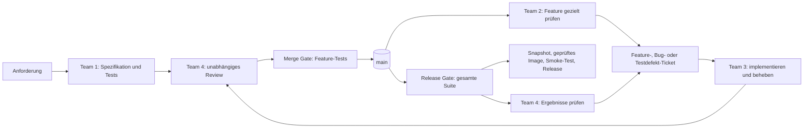

# AGENTS.md – Arbeitsweise in AI Perspectives

Repository: [MarvinJakob/AIPerspectives](https://github.com/MarvinJakob/AIPerspectives) · Projekt: **AI Perspectives**, Besitzer `MarvinJakob` · [Architektur](ARCHITECTURE.md)

Vier Teams arbeiten parallel. Übergaben laufen ausschließlich über Repository, Issues, PRs und Board. Jeder Worker bearbeitet genau eine Aufgabe und endet nach Abschluss oder gesicherter Übergabe. Keine direkten Absprachen und keine Änderungen an fremden Worktrees. Unabhängiges Review ist eine eigene Aufgabe einer anderen Sitzung.

**Aktuelle Regeln:** Vor jeder Aufgabenwahl und Übergabe diese zentrale `AGENTS.md` im Hauptverzeichnis erneut lesen. Zusätzlich `bash tools/work.sh --check` ausführen. In einem alten Checkout ohne dieses Skript: `git fetch origin main`, dann `git show origin/main:tools/work.sh | bash -s -- --check`. Der Bootstrap lädt Werkzeuge und Rollen-Dateien aus einem unveränderlichen Checkout von `origin/main`, ohne den Haupt-Checkout anzufassen. Ein ausdrücklich beauftragter, lokal aktualisierter zentraler Prozess hat bei Abweichungen Vorrang; veraltete Rollen-Dateien dürfen ihn nicht überschreiben. Der Maintainer veröffentlicht Prozessänderungen über einen Wartungs-PR. Bestehende Änderungen und fremde Belegungen erhalten.

| Team | Ziel | Rollen-Datei |
|---|---|---|
| 1 · Analyst | Anforderungen vollständig spezifizieren und Fidelity-Tests schreiben; Prüfung durch Lesen | [AGENTS_ANALYST.md](AGENTS_ANALYST.md) |
| 2 · Feature-Tester | einzelne Tests und Feature-Teilläufe ausführen, Ergebnisse prüfen, Feature- und Bug-Tickets schreiben, Baseline führen | [AGENTS_TESTER.md](AGENTS_TESTER.md) |
| 3 · Implementierer | Features implementieren, Bugs und Testdefekte beheben, relevante Unit-Tests pflegen | [AGENTS_FIXER.md](AGENTS_FIXER.md) |
| 4 · Reviewer und Release-Tester | unabhängiges Review von PRs und Anforderungen mit Folgetickets, gesamte Testsuite im Release Gate auswerten, Bug-Tickets schreiben, Auslieferung verfolgen | [AGENTS_REVIEWER.md](AGENTS_REVIEWER.md) |



## Auftrag und Aufgabenwahl

Aufträge: `Team 1`, `Team 2`, `Team 3`, `Team 4`, optional mit Issue (`Team 3 #45`). `Reviewer` und `review` sind Aliase für Team 4. Ohne Issue die erste freie Aufgabe der eigenen Rolle aus der vollständigen Warteschlange übernehmen; ist keine frei, melden und enden. Eine leere Label-Suche beweist kein leeres Board.

Bei `work` hat ein ausdrücklich genanntes Team Vorrang. Sonst gilt die Reihenfolge der Warteschlange:

1. Team 3: Release-Blocker (Bug, Feature oder Testdefekt).
2. Team 4: freigegebene PRs in `Review` / `Merge Gate`; nie die eigene Implementierung. Dazu gehört das Anforderungs-Review: eine Anforderung in `Merge Gate`, deren offene Folgetickets alle einen offenen PR in `Review` / `Merge Gate` haben, ohne Merker `requirement-reviewed` ([AGENTS_REVIEWER.md](AGENTS_REVIEWER.md)). Hat ein Folgeticket noch keinen PR im Review, ist die Anforderung für kein Team frei.
3. Freigegebene Zwischenstände in `In Progress` / `In Arbeit`, Rolle entsprechend dem Branch.
4. Autorisierte Wartung, einschließlich Release-Nacharbeit für Team 4; dann Team 3 Testdefekte; Team 2 spezifizierte Anforderungen ohne offene Folgetickets; Team 3 Bugs und Features; Team 1 Anforderungen in `Neu` / `Ready`, auch bei fehlenden Anforderungslabels. Je Stufe ältestes Ticket zuerst.

Aktive Sperren nie überschreiben. Frei heißt: keine aktive lokale Belegung, kein `in-progress`, kein `waiting-for-test` und kein unbeantworteter Blocker. Ein Boardstatus allein gibt keinen Worktree frei: Übernahme nur nach `pause` und erfolgreichem `resume`. Claim/Resume mit Exitcode 2 → nächste passende Aufgabe; andere Fehler diagnostizieren, nicht als leeres Backlog melden. Team und Issue im Chat nennen. Nach Übergabe keine zweite Aufgabe; der Supervisor startet bei Bedarf eine frische Sitzung.

## Zuständigkeiten und Prüfungen

| Prüfung | Zuständig | Umfang |
|---|---|---|
| Spezifikation und Testquelltext | Team 1 | eigene Anforderung; kein Server, kein Testlauf, keine Gegenprobe |
| Testvalidierung und Funktionsnachweis | Team 2 | nur eigenes Feature, Desktop und Mobil; Gegenproben vollständig zurücknehmen |
| Implementierung und lokale Tests | Team 3 | eigene Aufgabe, betroffene Unit-Tests und bei Bedarf gezielte Feature-Tests |
| PR-Abnahme | Team 4 | Diff, Issue, Spezifikation, Sicherheit, Wartbarkeit, aktueller Commit |
| Merge Gate | Actions | Build, Unit-Tests, Security, Prozessprüfungen, Review-Nachweis und ausschließlich Fidelity-Tests der PR-Features |
| Release Gate | Actions, ausgewertet durch Team 4 | alle Unit- und Fidelity-Tests, gesamte Baseline, Final Check, Deployment und Smoke-Test |

**Die gesamte Fidelity-Suite läuft ausschließlich im Release Gate.** Kein Team und kein zweiter Workflow startet sie separat. Team 4 veranlasst bei Diagnosebedarf `gh workflow run release.yml -f ref=<main-Commit> -F tests-only=true`; dieser Modus führt Release-Tests ohne Deployment und Veröffentlichung aus. Er ist kein Produktionsnachweis.

Actions ersetzen keine nötige gezielte Reproduktion oder Testvalidierung. Vollständige CI-Prüfungen nicht lokal doppeln. Rote neue Tests sind fachlicher Backlog; defekte, übersprungene oder unvollständige Läufe sind kein gültiger Nachweis.

## Gemeinsame Regeln

1. **Zugang:** GitHub über `GH_TOKEN` für `gh` und `git`. Secret-Werte nie ausgeben, speichern oder committen. Hetzner nur über Actions-Secrets `HETZNER_CLOUD_API` und `HETZNER_CLOUD_SSH`; `HCLOUD_TOKEN` ist der interne Name der Snapshot-Action. Keine lokalen Hetzner-Zugänge als Ersatz.
2. **Eine Aufgabe, ein Worktree:** `bash tools/task.sh claim <spec|verify|fix|maint> <n>`. Danach sofort `bash tools/board.sh <n> "In Arbeit"` und `bash tools/board.sh get <n>`; erst bei bestätigtem Status fachlich arbeiten. Alle Änderungen, Builds und Commits im eigenen Worktree. Im Hauptverzeichnis weder Branch wechseln noch committen. Ausdrücklich beauftragte zentrale `AGENTS*.md` dürfen dort unter Erhalt bestehender Änderungen aktualisiert werden.
3. **Sitzung und Sperre:** `AGENT_ID` bezeichnet die echte Sitzung, bei Codex wird `CODEX_THREAD_ID` verwendet. Regelmäßig `bash tools/task.sh heartbeat <team> <n>`; `status` zeigt Besitzer, Lebenszeichen und Operationssperren. Alter allein erlaubt keine Übernahme.
4. **Dateigrenzen:** siehe Tabelle. Prozess-/Infrastrukturänderungen nur mit ausdrücklichem Wartungsauftrag. Keine Gates umgehen, keine fachlichen Kriterien abschwächen.
5. **Commit und PR:** Conventional Commit mit Issue-Nummer. Vor Push `git fetch origin && git rebase origin/main`; betroffene gezielte Prüfungen wiederholen (Team 1 prüft nur durch Lesen). PRs nach Vorlage; echte Implementierer-IDs dokumentieren. Keine vorgetäuschten Reviews oder ungeprüft abgehakten Prüfpunkte.
6. **Blocker:** konkrete Frage und Stand in Datei, `bash tools/board.sh block <n> <Datei>`, Status prüfen. Ergebnisse committen/pushen, Übergabe dokumentieren, `pause`. Kein `finish --abandon` für benötigte Übergaben. Nach Antwort verschiebt der Maintainer nach `In Progress`; Übernehmer liest Antwort, `unblock`, `resume`.
7. **Sparsam lesen:** zentrale Regeln, eigene Rolle, Issue, betroffene Spezifikation und Code. `content/`, `res/`, `mock/` nur bei ausdrücklichem Auftrag als fachliche Quelle verwenden. `content/archive/` nie lesen.
8. **Eigene Laufzeit:** Team 2/3 verwenden Port `20000 + <n>` und Datenbank im Worktree. Server nach der Arbeit beenden. Team 1 startet keinen Server.

| Team / Aufgabe | Branch | Erlaubte Änderungen |
|---|---|---|
| Team 1 | `spec/<n>` | `fidelity/specs/`, `fidelity/tests/` |
| Team 2 | `verify/<n>` | `fidelity/baseline.txt`, nur gültige neue IDs am Ende |
| Team 3 | `fix/<n>` | `app/`; bei verknüpftem Issue mit `test-defect` auch betroffene `fidelity/tests/` und nötige `fidelity/specs/` |
| Team 4 Review | übernimmt freigegebenen Aufgaben-Worktree | keine Implementierungsänderungen; Befunde an PR/Issue |
| Wartung | `codex/maint-<n>` | nur ausdrücklich beauftragter Prozess-/Infrastrukturumfang |

Nur Team 2 ergänzt die Baseline nach Funktionsnachweis. Eine Testkorrektur allein ist kein Nachweis. Keine Team-Aufgabe entfernt Baseline-IDs. Fachlich ersetzte Kriterien erhalten neue IDs; bestehende IDs entfernt nur der Maintainer in ausdrücklich beauftragter Wartung.

## Labels und Board

Labels bestimmen den Aufgabentyp, Board und Sperre den Bearbeitungsschritt. Vor Auswahl alle Board-Einträge lesen (`bash tools/board.sh list`, vollständig paginiert). Neue Anforderungen ohne Labels in `Neu` gehören Team 1; fehlende Labels ergänzen. Bugs, Features und Testdefekte gehören Team 3; freie falsch einsortierte Tickets nach `Bug offen` verschieben.

| Label | Bedeutung | Wartestatus |
|---|---|---|
| `requirement` + `needs-analysis` | Anforderung für Team 1 | Neu / Ready |
| `requirement` + `specified` | Tests auf `main`, Team 2 prüft das Feature | Spezifiziert; mit offenem Folgeticket Merge Gate (Anforderungs-Review durch Team 4, sobald alle Folgetickets einen PR im Review haben) |
| `requirement-reviewed` | Anforderungs-Review durch Team 4 abgeschlossen; verhindert Wiederholung, der Prozessabgleich entfernt es bei neuem Folgeticket ohne PR oder ohne offene Folgetickets | Merge Gate |
| `feature` | fehlende neue Funktion, Implementierungsauftrag für Team 3 | Bug offen |
| `bug` | fehlerhaftes vorhandenes Verhalten, Team 3 | Bug offen |
| `test-defect` | falscher oder instabiler Test, Team 3 | Bug offen |
| `release-blocker` | Baseline-Regression oder anderer nachgewiesener Release-Fehler; sperrt Deployment | Bug offen |
| `works` | Funktionsnachweis durch Team 2, sofort geschlossen | Funktioniert |
| `done` | alle Kriterien in Baseline, keine offenen Folgetickets, geschlossen | Funktioniert |
| `release-failure` | Release-Nacharbeit durch Team 4 | Neu / Blocked |
| `release-review` | Auswertung eines erfolgreichen Release-Testlaufs durch Team 4, auch bei fachlichem Backlog | Neu |
| `maintenance` + `maintenance-approved` | ausdrücklich autorisierte Wartung | Neu / Review |
| `in-progress` | aktive Belegung | In Arbeit / Review |
| `blocked` | konkrete unbeantwortete Rückfrage | Blocked |
| `waiting-for-test` | Implementierung wartet auf getrenntes Testdefekt-Ticket von Team 3 | In Arbeit, freigegeben |

Historische geschlossene `feature`-Tickets als Erfolgsnachweis bleiben erhalten; neue Erfolgsnachweise verwenden `works`. Neue offene `feature`-Tickets sind Implementierungsaufträge. Folgetickets nennen `[REQ-<n>-AC<m>]` im Titel; Warteschlange und Abgleich erkennen so Abhängigkeiten.

**Statuspflege:** bei Übernahme, Übergabe, PR, Merge und Abbruch `board.sh` ausführen und mit `get` prüfen. `Review` ist Alias für `Merge Gate`, `In Progress` für `In Arbeit`, `Ready` für `Neu`. Bei Fehlern erneut prüfen; ungelösten Fehler und gewünschten Zielstatus im Issue und Abschluss nennen, keinen erfolgreichen Wechsel behaupten. Fremde aktive Belegungen nicht verändern.

`node tools/reconcile.mjs --apply --board` gleicht Labels/Board aus gemergten Spezifikationen, Baseline und offenen Folgetickets ab. Der Prozessabgleich setzt `specified`, stellt Anforderungen mit offenen Folgetickets nach `Merge Gate` (ohne offene Folgetickets nach `Spezifiziert`), pflegt den Merker `requirement-reviewed`, schließt erfüllte Anforderungen und löst Testabhängigkeiten. Keine fremden Dateien oder Sperren bereinigen.

## Übergabe und Wiederaufnahme

**Übergabe:** Änderungen committen/pushen, Issue/PR mit Branch, Commit, echten Implementierer-IDs, Prüfergebnissen und nächstem Schritt ergänzen. Board nach `Review`, `Blocked` oder `In Progress`, Status prüfen, Server beenden, `bash tools/task.sh pause <team> <n>`. Branch und Worktree bleiben erhalten, `in-progress` wird entfernt.

**Übernahme:** ausschließlich nach Freigabe `resume <team> <n>`. Für Team 4 ist `<team>` der Präfix der abgenommenen Aufgabe (`spec`, `verify`, `fix`, `maint`), kein neuer Review-Branch. Bei Befunden zurück an Implementierer und erneut `pause`; jeder neue Commit braucht ein neues Review.

**Abschluss:** nur nach grünem Merge Gate mergen: `gh pr checks <PR> --watch`, dann `gh pr merge <PR> --squash --delete-branch`. Nie `--admin`. Zielstatus setzen/prüfen, dann `bash tools/task.sh finish <team> <n>`; entferntes `in-progress` prüfen. Ohne Änderungen kann Team 2 nach dokumentierter Auswertung ohne PR abschließen. Anforderungen bleiben bis zum Baseline-Nachweis offen.

**Absturz:** keine automatische Übernahme. Maintainer-Freigabe am Issue mit `Recover-Task: <team>/<n>`, `Owner: <ID>`, `Operation-Lock: <Objektwert oder none>`; `tools/recover-task.mjs` prüft sie. Legacy-Worktrees ohne Besitzerdaten zuerst anhand dokumentierter Herkunft migrieren. Unterbrochenes `finish` wiederholen, nicht erneut implementieren.

## Merge Gate

### Feature mit zugeordneten Bugs

Nach der Implementierung durch Team 3 wartet das Ursprungsticket mit seinem Draft-PR in `Merge Gate`. Solange zugeordnete Bugs offen sind, bleibt es dort; die Bugs sind eigene Team-3-Aufgaben in `Bug offen`. Das Warten belegt keinen Agenten und keinen Worktree. Aktive Übernahmen verwenden weiterhin bestätigtes `In Arbeit` und enden mit gesicherter Freigabe.

Neue Test- oder Review-Befunde erhalten nach Duplikatsuche ein eigenes Bug-Ticket mit der eigenständigen Zeile `Feature-Ticket: #<Ursprungsticket>` im Issue-Text. Dafür `node tools/feature-bug.mjs <Ursprungsticket> <Befund-Datei>` verwenden (erste Zeile: Titel; danach erwartetes/tatsächliches Verhalten, Reproduktion, IDs und Test-Commit). Der Titel mit REQ-ID bezeichnet weiterhin die Anforderung; `Feature-Ticket` ordnet den Bug dem konkreten Implementierungsticket zu. Bei manuell angelegten Tickets dieselbe Zeile setzen und `Bug offen` separat bestätigen. Vorhandene Bugs wiederverwenden. Verschachtelte Folgefehler gehören ebenfalls zum Ursprung; Verknüpfungen dürfen keine Zyklen bilden. Keine neuen Belegungslabels.

Jeder Bug behält seinen eigenen Worktree und PR einschließlich unabhängigem Review. Ein Bug gilt für das abschließende Feature-Review erst mit `closed` / `completed` und gemergtem Fix-PR als behoben; `not_planned`, ein geschlossener ungemergter PR oder ein grüner Einzellauf reichen nicht. Bereits anderweitig behobene Bugs nennen `Fix-PR: #<gemergter PR>` als Nachweis. Der Ursprung wartet währenddessen im Merge Gate. Das Verfahren verlangt keinen gemeinsamen Implementierungs-Worktree und keine Änderung fremder Branches.

Nach dem letzten abgeschlossenen Bug nimmt die Warteschlange automatisch das abschließende Team-4-Review des Ursprungstickets auf. Der laufende `work`-Orchestrator beziehungsweise `work.sh --watch` startet dafür eine neue unabhängige Sitzung; ohne laufenden Supervisor startet GitHub keinen lokalen Agenten. Ein auf Team 3 beschränkter Auftrag startet keine Team-4-Sitzung. Keine wiederholten Starts unverändert wartender Features.

Team 4 reviewed den aktuellen Feature-Stand einschließlich sämtlicher zugeordneten Fix-PRs und deren Wechselwirkungen. Vor Abnahme den eigenen freigegebenen Feature-Branch auf aktuelles `main` bringen; alle Fix-Merge-Commits müssen im geprüften Head enthalten sein. Der Reviewer darf weder den Ursprung noch einen seiner Fixes selbst implementiert haben. Zugeordnete abgeschlossene Fix-PRs sind Nachweise dieser einen Feature-Review-Aufgabe, keine Übernahme fremder Worktrees. `review.mjs` dokumentiert zusätzlich `Reviewed-Feature-Fixes` im PR und im GitHub-Review. Neue, wieder geöffnete oder anders zugeordnete Bugs entziehen die Review-Freigabe; Änderungen des Fix-Satzes erfordern eine neue unabhängige Abnahme.

Issue-Ereignisse lassen betroffene Merge Gates erneut prüfen. Das Gate prüft den aktuellen Abhängigkeitsstand auch unmittelbar vor seinem Abschluss. Nur mit aktuellem Review und grünem Merge Gate mit `node tools/merge.mjs <PR> <geprüfter SHA>` mergen; das Werkzeug prüft die Live-Abhängigkeiten nach den CI-Checks erneut und verwendet den exakten Head. Der Merge auf `main` startet das bestehende Release Gate mit automatischem Deployment und Versionsveröffentlichung. Ein gemergter PR allein bestätigt noch kein erfolgreiches Deployment.

[merge-gate.yml](.github/workflows/merge-gate.yml) ist Pflichtprüfung jedes PR nach `main`: Team-Grenzen, Produktionsbuild, Unit-Tests einschließlich Race-Tests, Security, Prozessprüfungen, aktuelles unabhängiges Review und **nur Fidelity-Tests der betroffenen Features**. Branch vor Merge aktuell halten.

Feature-Auswahl: IDs aus `Fidelity:`, neue Baseline-IDs und geänderte Dateien einschließlich Feature-Hilfsdateien `fidelity/{tests,specs}/REQ-<n>.*`. Alle Tests dieser Features laufen auf Desktop und Mobil. Bestehen müssen geforderte IDs und Baseline-IDs dieser Features. Neue noch nicht implementierte Kriterien dürfen rot sein; globale Laufzeitfehler, fehlende ausgewählte IDs und Skip sperren das Gate, instabile Ergebnisse sind kein Funktionsnachweis. Die gesamte Baseline wird erst im Release Gate geprüft.

| PR | Issue-Bezug | Fidelity und Review |
|---|---|---|
| `spec/<n>` | `Refs #<Anforderung>` | Feature automatisch aus geänderten Dateien; Team 4 reviewed Quelltext, Team 2 validiert zur Laufzeit |
| `verify/<n>` | `Refs #<Anforderung>` | neue Baseline-IDs müssen bestehen; automatischer Nachweis ersetzt zusätzliches Agenten-Review |
| `fix/<n>` | `Closes #<Feature/Bug/Testdefekt>` | `Fidelity:` mit erfüllten Ticket-IDs; bei Testdefekt automatisch betroffene Features und deren Baseline; Team 4 reviewed |
| `codex/maint-<n>` | `Closes #<Wartung>` | Feature-Bezug falls vorhanden, sonst kein Fidelity-Teillauf; andere Prüfungen und Team-4-Review gelten |

PRs mit Review zunächst als Draft. Alle Jobs außer „Review“ und Abschlussjob müssen vor Übergabe grün sein; ein bei reiner Wartung gezielt ausgelassener Fidelity-Job ist zulässig. Team 4 dokumentiert die Abnahme des exakten Head-Commits mit `tools/review.mjs`; danach Draft aufheben. PR-Textänderungen starten das Gate erneut.

## Release Gate

[release.yml](.github/workflows/release.yml) startet automatisch nach jedem Merge/Push auf `main`. Commit einmal festlegen → Build und Unit-Tests parallel → gesamte Fidelity-Suite gegen das gebaute Image → gesamte Baseline und offene Release-Blocker prüfen → Snapshot → genau dieses Image nach Hetzner übertragen → Health und Produktions-Smoke-Test → erst dann Branch `release`, Tag und GitHub-Release.

Neue fachliche Fehlschläge außerhalb der Baseline sind erlaubter Backlog; Team 4 schreibt hierfür Feature-/Bug-Tickets und für Regressionen zusätzlich `release-blocker`. Ungültige oder unvollständige Läufe sperren das Release. Team 4 wertet auch grüne Berichte auf neue Backlog-Befunde aus. Vollsuite-Ausführung bedeutet nicht, dass unfertige Anforderungen als umgesetzt gelten.

Deployments und Rollbacks sind serialisiert (`release-production`), laufende Deployments werden nicht durch Merges abgebrochen. Mehrere wartende Releases können zum neuesten Stand zusammenfallen. Ältere Kandidaten dürfen einen bereits neueren Release-Stand nicht zurückrollen. Bei Deployment- oder Smoke-Fehler wird die vorherige Version wiederhergestellt; ohne Vorgänger ist explizite Wiederherstellung nötig. Diagnose mit `tests-only=true` veröffentlicht nichts und verwendet eine eigene Concurrency-Gruppe, damit sie keine wartenden Produktionsreleases verdrängt. Der tatsächlich getestete Commit steht im Artefakt `release-metadata`. [Details](ARCHITECTURE.md#7-auslieferung).

## Wartung und Betrieb

Prozessdateien, Workflows, Werkzeuge und Fidelity-Auswertung nur aufgrund ausdrücklichen Maintainer-Auftrags; Issue mit `maintenance` und `maintenance-approved`. Belegen mit `claim maint <n>`, unabhängiges Review und Gate bleiben Pflicht. Team 4 darf den dokumentierten Umfang autorisierter Release-Nacharbeit als Wartung bearbeiten, dann reviewed eine andere Sitzung.

`tools/work.sh --once` startet einen Worker für genau eine Aufgabe. `--watch` / `tools/work-watch.ps1` beobachten neue Arbeit und starten frische Sitzungen. Echte Fehler stoppen den Supervisor; keine Sperren umgehen. `Ctrl+C` lässt die aktive Sitzung ihre Übergabe abschließen.

## Befehle

Team 2/3 im eigenen Worktree, `P = 20000 + <Issue-Nummer>` (Git Bash):

```bash
(cd app/frontend && npm ci && npm run build) && (cd app/frontend-redaktion && npm ci && npm run build)
(cd app/backend && CGO_ENABLED=0 go build -o ../.build/server ./cmd/server)
(cd app && DEV_SEED=true SERVE_MEDIA=true ADDR=127.0.0.1:$P PUBLIC_BASE_URL=http://localhost:$P DATABASE_PATH=.build/dev.db MEDIA_PATH=.build/media ./.build/server &)
cd fidelity && npm ci && npx playwright install chromium
export BASE_URL=http://localhost:$P
npx playwright test --grep '\bREQ-12-AC[0-9]+\b' --list --reporter=json > inventory.json
npx playwright test --grep '\bREQ-12-AC[0-9]+\b'
node scripts/gate.mjs --inventory inventory.json --no-baseline
```

Kein ungefiltertes `npm test` / `playwright test` in `fidelity/` außerhalb des Release Gate. Unit-Tests betroffener Pakete und Code-Erzeugung: [app/README.md](app/README.md). Team 1 führt diese Befehle nicht aus.
