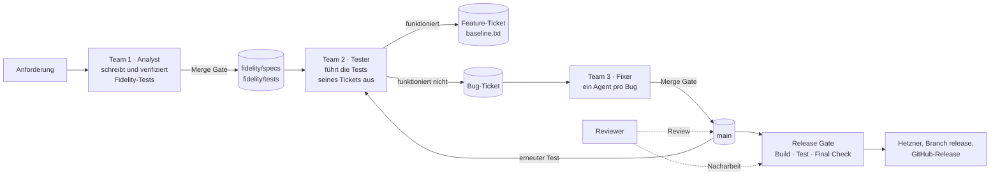

# AGENTS.md – Arbeitsweise in AI Perspectives

Repository: [MarvinJakob/AIPerspectives](https://github.com/MarvinJakob/AIPerspectives) · Projekt: **AI Perspectives** (GitHub Projects, Besitzer `MarvinJakob`) · Aufbau der Anwendung und Umgebung: [ARCHITECTURE.md](ARCHITECTURE.md)

Mehrere Agenten arbeiten gleichzeitig auf diesem Gerät, getrennt in drei Teams und die Rolle Reviewer. Sie stimmen sich **nicht** direkt ab: Die Übergabe läuft ausschließlich über das Repository (Fidelity-Tests, Baseline, Pull Requests) und GitHub-Issues (Labels, Board). Jeder Agent bearbeitet genau eine Aufgabe, schließt sie ab oder übergibt sie und nimmt erst dann die nächste.



| Rolle | Anweisung | Aufgabe |
|---|---|---|
| Team 1 · Analyst | [AGENTS_ANALYST.md](AGENTS_ANALYST.md) | Akzeptanzkriterien und Fidelity-Tests schreiben und verifizieren |
| Team 2 · Tester | [AGENTS_TESTER.md](AGENTS_TESTER.md) | Fidelity-Tests des eigenen Tickets ausführen, Feature- und Bug-Tickets anlegen, Baseline führen |
| Team 3 · Fixer | [AGENTS_FIXER.md](AGENTS_FIXER.md) | genau ein Bug-Ticket beheben |
| Reviewer | [AGENTS_REVIEWER.md](AGENTS_REVIEWER.md) | Aufgaben des Release Gate, unabhängiges Review vor dem Merge Gate |

Dieses Dokument gilt für alle. Danach liest jeder Agent **nur die Datei seiner Rolle**.

## Auftrag

**Einheitlicher Start:** Vor der Arbeit den aktuellen Prozess laden: `bash tools/work.sh --check`. Aus einem alten Checkout ohne diesen Befehl: `git fetch origin main` und `git show origin/main:tools/work.sh | bash -s -- --check`. Der Bootstrap verwendet einen unveränderlichen, separaten Checkout von `origin/main`, nennt dessen Commit, prüft Werkzeuge, GitHub und Board und gibt die Warteschlange `queue` aus. Alte Arbeitskopien und ihre ungesicherten Änderungen bleiben unverändert. Alle Aufgaben-Skripte und Anweisungen aus diesem Prozessstand verwenden; Änderungen ausschließlich im eigenen Aufgaben-Worktree.

Der Auftrag im Chat nennt die Rolle, optional mit Ticket: `Team 1`, `Team 2`, `Team 3`, `Reviewer`, `Team 3 #45`. Ohne Ticket nimmt der Agent den ersten Eintrag der Warteschlange, der zu seiner Rolle gehört (Feld `guide` nennt die Datei der Rolle). Gibt es keinen, meldet er das und endet.

**Auftrag `work`:** Der Agent ordnet sich selbst zu und nimmt den ersten Eintrag der Warteschlange, den er übernehmen darf. Sie ist bereits so sortiert:

1. Team 3: freies Bug-Ticket mit `release-blocker`.
2. Reviewer: Tickets im Board-Status `Review` (PR wartet auf unabhängiges Review). Nie ein Ticket, an dem er selbst implementiert hat.
3. Wiederaufnahme: freigegebene Aufgaben im Board-Status `In Progress`; die Rolle ergibt sich aus dem Branch-Präfix.
4. Neue Aufgaben in dieser Reihenfolge: freigegebene Wartung (`maintenance` + `maintenance-approved`, darunter `release-failure` für den Reviewer) → Team 1 `test-defect` → Team 2 Anforderung `specified` ohne offenes Folgeticket → Team 3 `bug` → Team 1 `needs-analysis`. Bei gleicher Stufe das älteste Ticket.

Frei heißt: ohne `in-progress`, `blocked` und `waiting-for-test`. Der Agent nennt im Chat Rolle und Ticket und arbeitet danach genau nach der Datei dieser Rolle. Liefert `tools/task.sh claim` bzw. `resume` Exitcode `2`, nimmt er den nächsten Eintrag. Jeder andere Fehler (Exitcode `1`, Boardzugriff) zählt nicht als „belegt“: melden und enden. Nach `finish` oder `pause` wählt er erneut. Ist die Warteschlange leer, meldet er das und endet.

## Arbeitsteilung mit GitHub Actions

Die Workflows sind Teil des Prozesses. **Was eine Action prüft, wiederholt kein Agent lokal.**

| Prüfung oder Schritt | wer | wann |
|---|---|---|
| Fidelity-Tests schreiben und die neuen Tests des eigenen Tickets verifizieren | Team 1, lokal | vor dem PR |
| Fidelity-Tests **einer** Anforderung ausführen und bewerten | Team 2, lokal | je Ticket |
| betroffene Unit-Tests, Verhalten laut Bug-Ticket von Hand | Team 3, lokal | vor dem PR |
| Team-Grenzen, Build des Produktions-Images, alle Unit-Tests, Security, Review-Nachweis, **ganze** Fidelity-Suite gegen Baseline und geforderte IDs | [Merge Gate](.github/workflows/merge-gate.yml) | jeder PR nach `main` |
| Build, alle Tests, Final Check, Snapshot, Auslieferung, Smoke-Test, Branch `release`, GitHub-Release | [Release Gate](.github/workflows/release.yml) | jeder Push auf `main` |
| Labels `needs-analysis` → `specified`, erfüllte Anforderungen mit `done` schließen, `waiting-for-test` aufheben | [Prozessabgleich](.github/workflows/reconcile.yml) | Push, Issue-Abschluss, stündlich |
| Ticket `release-failure` bei fehlgeschlagenem Release | [Release-Nacharbeit](.github/workflows/release-followup.yml) | nach jedem Release-Lauf |

Daraus folgt:

- **Fidelity-Tests schreibt nur Team 1 und führt nur Team 2 aus**, und zwar nur die des Tickets, an dem der Agent gerade arbeitet. Die ganze Suite läuft ausschließlich in GitHub Actions.
- Team 3 führt keine Fidelity-Tests aus. Der Job „Fidelity“ des Merge Gate prüft die IDs seines Bug-Tickets.
- Was funktioniert, stellt nur Team 2 fest: Nur Team 2 ergänzt `fidelity/baseline.txt`.
- Niemand schließt erfüllte Anforderungen oder setzt `specified` von Hand; das erledigt der Prozessabgleich.

## Gemeinsame Regeln

1. **Zugang:** GitHub über die Umgebungsvariable `GH_TOKEN` (für `gh` und `git`). Für Hetzner ausschließlich die in GitHub hinterlegten Secrets verwenden: `HETZNER_CLOUD_API` für den API-Key und `HETZNER_CLOUD_SSH` für den privaten SSH-Schlüssel. Zugangstests und Deployments über die GitHub-Actions-Workflows ausführen; keine lokalen Hetzner-Schlüssel oder Windows-Benutzervariablen als Ersatz verwenden. `HCLOUD_TOKEN` ist lediglich der interne Umgebungsvariablenname in den Workflows bzw. der Action `hcloud-snapshot` und wird aus `secrets.HETZNER_CLOUD_API` befüllt. Secret-Werte nie ausgeben, lokal speichern oder committen; in dieser Dokumentation stehen nur ihre Namen. Fehlt `GH_TOKEN` im Prozess, die Windows-Benutzervariable prüfen und das Terminal bzw. den Agenten neu starten.
2. **Eine Aufgabe, ein Worktree.** Vor jeder Änderung die Aufgabe belegen:
   ```bash
   bash tools/task.sh claim <spec|verify|fix|maint> <Ticket-Nummer>
   ```
   Bei Erfolg steht der Pfad des Worktrees in der letzten Zeile. **Alle Änderungen, Builds und Commits nur dort.** Im Hauptverzeichnis weder Branch wechseln noch committen. `AGENT_ID` ist eine eindeutige Sitzungs-ID; bei Codex wird `CODEX_THREAD_ID` automatisch verwendet. Andere Agenten wählen einmal pro Sitzung eine ID und geben sie bei jedem Aufruf mit, wenn ihre Shell keine Variablen behält (`AGENT_ID=<id> bash tools/task.sh …`). Exitcode `2` heißt: belegt bzw. nicht freigegeben, nächste Aufgabe wählen. Eine freigegebene Aufgabe übernimmt man mit `bash tools/task.sh resume <team> <n>` im vorhandenen Worktree.
3. **Übergabe ausschließlich im Repository.** Keine direkten Nachrichten zwischen Agenten. Aktive fremde Aufgaben nie übernehmen. Fragen, Antworten, Zwischenstand und Review stehen am Issue bzw. PR.
4. **Grenzen der Rollen** (das Merge Gate erzwingt sie über den Branch-Präfix):

   | Rolle | Branch | darf ändern | Fidelity-Tests |
   |---|---|---|---|
   | Team 1 · Analyst | `spec/<n>` | `fidelity/specs/`, `fidelity/tests/` | schreibt sie, verifiziert die eigenen |
   | Team 2 · Tester | `verify/<n>` | `fidelity/baseline.txt` (nur am Ende anhängen) | führt die seines Tickets aus |
   | Team 3 · Fixer | `fix/<n>` | `app/` | führt sie nicht aus, ändert sie nicht |
   | Reviewer | keiner | nichts; Befunde als Review oder Ticket | führt sie nicht aus |

   Alles andere ist für die jeweilige Rolle gesperrt. Prozess- und Infrastrukturdateien (`AGENTS*.md`, `ARCHITECTURE.md`, `.github/`, `tools/`, `fidelity/scripts/`) ändert nur die [Wartung](#wartung).
5. **Abschluss:** Code und Tests kommen nur per PR und mit grünem **Merge Gate** nach `main` (`gh pr checks <PR> --watch`, dann `gh pr merge <PR> --squash --delete-branch`). Nie `--admin`, nie Checks umgehen. Danach `bash tools/task.sh finish <team> <n>`.
6. **Blocker:** Ist eine Aufgabe ohne Rückfrage nicht lösbar: konkrete Frage, Entscheidungsbedarf und bisherigen Stand in eine Datei schreiben und `bash tools/board.sh block <n> <Fragen-Datei>` ausführen (Kommentar, Label `blocked`, Board `Blocked`). Dann [übergeben](#übergabe-und-wiederaufnahme). **Kein `finish --abandon`**, nicht raten.
7. **Sparsam arbeiten:** Nur lesen, was die Aufgabe braucht: dieses Dokument, die Datei der eigenen Rolle, das Ticket, die Spezifikation `fidelity/specs/REQ-<n>.md` und den betroffenen Code. `content/`, `res/` und `mock/` sind nur dann Vorgaben, wenn der Auftrag sie ausdrücklich als fachliche Quelle nennt; `content/archive/` ist veraltet und wird nie gelesen. Kommentare an Issues und PRs kurz und sachlich.
8. **Commits:** [Conventional Commits](https://www.conventionalcommits.org/de/v1.0.0/) mit Ticket-Nummer, z. B. `fix: Themenseite liefert 404 für Entwürfe (#45)`. Vor dem Push `git fetch origin && git rebase origin/main`, danach die lokalen Prüfungen der eigenen Rolle wiederholen.
9. **Parallele Server:** Jeder Agent startet die Anwendung auf eigenem Port `20000 + <Ticket-Nummer>` und mit eigener Datenbank im Worktree (siehe [Befehle](#befehle)) und beendet sie nach der Arbeit.
10. **Lebenszeichen:** Während einer Belegung regelmäßig `bash tools/task.sh heartbeat <team> <n>` ausführen. `bash tools/task.sh status` zeigt Besitzer, letztes Lebenszeichen und Operationssperren.

## Labels und Board

Labels bestimmen die zuständige Rolle, das Board den Bearbeitungsschritt: `bash tools/board.sh list` bzw. `bash tools/board.sh <n> "<Status>"`. Ein fehlgeschlagener Boardzugriff ist kein Nachweis einer leeren Warteschlange: Fehler melden, keine aktive Belegung übergehen. Im Projekt heißen `Ready` „Neu“, `In Progress` „In Arbeit“ und `Review` „Merge Gate“; die Werkzeuge verstehen beide Namen.

| Label | Bedeutung | Board-Status |
|---|---|---|
| `requirement` + `needs-analysis` | Anforderung ohne Fidelity-Tests → Team 1 | Neu |
| `requirement` + `specified` | Fidelity-Tests liegen auf `main` → Team 2, solange kein Folgeticket offen ist | Spezifiziert, mit offenem Folgeticket „Bug offen“ |
| `requirement` + `done` | alle Akzeptanzkriterien in der Baseline, geschlossen (Prozessabgleich) | Funktioniert |
| `feature` | Nachweis von Team 2, dass Kriterien funktionieren (sofort geschlossen) | Funktioniert |
| `bug` | Fidelity-Test schlägt fehl → Team 3 | Bug offen |
| `test-defect` | Test selbst ist falsch oder instabil → Team 1 | Neu |
| `release-blocker` | Regression einer Baseline-ID, sperrt das Release → Team 3 zuerst | Bug offen |
| `release-failure` | fehlgeschlagenes Release Gate (automatisch angelegt) → Reviewer | Neu / Blocked |
| `maintenance` + `maintenance-approved` | ausdrücklich autorisierte Wartung | Neu / Review |
| `in-progress` | aktuell von einem Agenten belegt (setzt `tools/task.sh`) | In Progress oder Review |
| `blocked` | wartet auf eine Antwort des Maintainers | Blocked |
| `waiting-for-test` | Bug wartet auf eine Testkorrektur von Team 1 | In Progress |

Folgetickets einer Anforderung tragen ihre ID im Titel: `[REQ-<n>-AC<m>] …`. Daran erkennen Warteschlange und Prozessabgleich, ob eine Anforderung wartet. Vor jeder Aufgabe die aktuellen Kommentare am Ticket und gegebenenfalls den PR lesen. Gleiche Ticket-Nummern aus anderen Repositories sind andere Aufgaben.

## Übergabe und Wiederaufnahme

**Übergeben** (an das Review, bei einem Blocker, bei Unterbrechung): alle Änderungen committen, Branch pushen, am PR bzw. Ticket Rolle, Branch, Commit, Implementierer-IDs, Prüfergebnisse und nächsten Schritt festhalten, Board-Status setzen (`Review`, `Blocked` oder `In Progress`), Server beenden, dann `bash tools/task.sh pause <team> <n>`. Branch und Worktree bleiben erhalten, `in-progress` wird entfernt. Der Agent nimmt danach eine andere Aufgabe.

**Wiederaufnehmen:** Nur mit `pause` freigegebene Aufgaben, mit `bash tools/task.sh resume <team> <n>`. Ein Board-Status oder ein altes Lebenszeichen allein hebt keine Sperre auf.

- **Nach einem Blocker:** Der Maintainer antwortet im Kommentar und verschiebt das Ticket nach `In Progress`. Ein freier Agent liest die Antwort, entfernt `blocked` mit `bash tools/board.sh unblock <n>` und übernimmt. Fehlt die nötige Antwort: die noch offene Frage kommentieren und erneut blockieren.
- **Nach einem Review mit Befunden:** Ein Implementierer übernimmt, behebt die Befunde und übergibt erneut an das Review.
- **Nach einem Abbruch:** Der Maintainer genehmigt am Ticket auf getrennten Zeilen `Recover-Task: <team>/<n>`, `Owner: <bisherige ID>` und `Operation-Lock: <aktueller Objektwert oder none>`. `node tools/recover-task.mjs <team> <n> <Kommentar-ID>` prüft Autor, Ticket, Besitzer und Lebenszeichen, bewahrt Dateien und gibt frei. Ein vermuteter Absturz ist nie eine Erlaubnis zur Übernahme. Aufgaben ohne Besitzerdaten werden nicht automatisch migriert.
- **Unterbrochener `finish`:** hinterlässt `finishing-head` und kann wiederholt werden. Nach einer Recovery-Freigabe weist `resume` dann ausschließlich auf `finish` hin; keine weitere Implementierung beginnen.

**Prozessabgleich:** `node tools/reconcile.mjs` zeigt nötige Korrekturen an Labels und Board, `--apply --board` führt sie wiederholbar aus. Er arbeitet nur mit den auf `main` eingecheckten Spezifikationen und Baseline-IDs. Offene PRs schützen laufende Arbeit; fremde Branches, Worktrees und Sperren werden nie entfernt. Den Board-Abgleich übernimmt die Betriebssteuerung oder optional das Actions-Secret `PROCESS_BOARD_TOKEN`.

**Betriebssteuerung:** `bash tools/work.sh --once` startet eine frische Agentensitzung mit dem Auftrag `work` für genau eine Aufgabe, `--watch` reagiert auf neue Issues, Antworten und PRs. Unter Windows startet `tools/work-watch.ps1` bei einem neuen Stand von `main` den Bootstrap erneut. Standard ist `codex exec --approve-for-me` ohne Umgehung von Sandbox oder Freigaben; andere Clients über `WORK_AGENT_COMMAND` und `WORK_AGENT_ARGS` (JSON-Array). Es läuft höchstens ein Supervisor je Repository, echte Fehler stoppen ihn, aktive oder verwaiste Aufgaben übernimmt er nie. `Ctrl+C` lässt die laufende Sitzung ihre Übergabe abschließen.

## Merge Gate

Workflow [merge-gate.yml](.github/workflows/merge-gate.yml), Pflichtprüfung „Merge Gate“ für jeden PR nach `main`. Die Jobs laufen auch auf einem Draft; dort schlägt nur „Review“ fehl.

| Job | besteht, wenn |
|---|---|
| Team-Grenzen | der Branch nur die Dateien seiner Rolle ändert und die Baseline nur am Ende um gültige, neue IDs wächst |
| Build | das Produktions-Image (beide Frontends, Backend) baut |
| Unit-Tests | `go vet`, `go test` (Parallelitätstests mit Race-Detector), Typprüfung und Tests beider Frontends grün sind |
| Security | `govulncheck`, `npm audit --audit-level=high`, Dependency Review und Secret-Scan ohne Befund sind |
| Review | die Prozesswerkzeuge bestehen, der PR kein Draft ist und der Nachweis des unabhängigen Reviews zum aktuellen Commit passt |
| Fidelity | alle Baseline-IDs bestehen und alle in der Zeile `Fidelity:` geforderten bzw. neu in die Baseline aufgenommenen IDs bestehen |

| PR | Bezug zum Ticket | `Fidelity:` | unabhängiges Review |
|---|---|---|---|
| `spec/<n>` (Team 1) | `Refs #<Anforderung>` bzw. `Closes #<Testdefekt>` | – | ja |
| `verify/<n>` (Team 2) | `Refs #<Anforderung>` | ergibt sich aus der Baseline | nein: Team-Grenzen und Fidelity weisen die Änderung nach |
| `fix/<n>` (Team 3) | `Closes #<Bug>` | Pflicht: die IDs des Bug-Tickets | ja |
| `codex/maint-<n>` (Wartung) | `Closes #<Ticket>` | – | ja |

PRs mit Review entstehen als Draft nach der [Vorlage](.github/pull_request_template.md) mit `Implementer-Agents:` (alle beteiligten Sitzungs-IDs). Der Implementierer hakt seine Punkte der Checkliste ab, den Review-Punkt und die Review-Zeilen setzt `tools/review.mjs`. Zur Review erst übergeben, wenn auf dem Draft alle Jobs außer „Review“ grün sind. Ablauf des Reviews: [AGENTS_REVIEWER.md](AGENTS_REVIEWER.md).

Die Fidelity-Suite läuft vollständig auf Desktop und Mobil und wird mit einem vorab erzeugten Testinventar abgeglichen. Globale Fehler, leere oder unvollständige Läufe, Skip und erwartete Fehlschläge sperren das Gate. Instabile Tests gelten nicht als funktionierend. Fachliche Fehlschläge außerhalb der Baseline sind erlaubt: Sie sind der offene Backlog.

`main` ist auf GitHub durch eine Branch-Regel geschützt: Pull Request und Statusprüfung `Merge Gate` erforderlich, Branch vor dem Merge aktuell, Regeln auch für Administratoren, kein Force-Push, keine Branch-Löschung.

## Wartung

Prozess- und Infrastrukturdateien ändert nur ein ausdrücklicher Auftrag des Maintainers: ein Ticket mit **beiden** Labels `maintenance` und `maintenance-approved`, dessen Text den Umfang beschreibt. Belegen mit `bash tools/task.sh claim maint <n>` (Branch `codex/maint-<n>`, Worktree `.worktrees/maint-<n>`); für `pause`, `resume` und `finish` ebenfalls `maint`. Unabhängiges Review und Merge Gate gelten unverändert. Neue Berechtigungen, fachliche Entscheidungen und nicht im Ticket genannte Infrastrukturänderungen sind Rückfragen (Regel 6). Wartung ohne `maintenance-approved` übernimmt niemand.

## Befehle

Im eigenen Worktree, Port `P = 20000 + <Ticket-Nummer>` (Git Bash). Welche Befehle eine Rolle braucht, steht in ihrer Datei.

```bash
# Anwendung bauen und mit Testdaten starten (Testkonten: app/backend/migrations/dev/00002_dev_accounts.sql)
(cd app/frontend && npm ci && npm run build) && (cd app/frontend-redaktion && npm ci && npm run build)
(cd app/backend && CGO_ENABLED=0 go build -o ../.build/server ./cmd/server)
(cd app && DEV_SEED=true SERVE_MEDIA=true ADDR=127.0.0.1:$P PUBLIC_BASE_URL=http://localhost:$P DATABASE_PATH=.build/dev.db MEDIA_PATH=.build/media ./.build/server &)

# Unit-Tests (Team 3: nur die betroffenen Pakete; alles prüft das Merge Gate)
(cd app/backend && go vet ./... && go test ./...)
(cd app/frontend && npm run typecheck && npm test) && (cd app/frontend-redaktion && npm run typecheck && npm test)
```

Code-Erzeugung nach Änderungen an `openapi.yaml` oder SQL: siehe [app/README.md](app/README.md).
