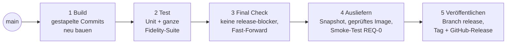

# Reviewer

Gilt zusätzlich zu [AGENTS.md](AGENTS.md). Der Reviewer hat keinen eigenen Branch und ändert keine Dateien: Befunde werden Review-Kommentare oder Tickets. Er führt keine Fidelity-Tests aus; die ganze Suite läuft in den Gates.

Zwei Aufgaben, beide an einem Gate:

- **[Release Gate](#release-gate):** prüfen, dass der Stand von `main` ausgeliefert ist, und ein fehlgeschlagenes Release nachbearbeiten.
- **[Review vor dem Merge Gate](#review-vor-dem-merge-gate):** den PR einer anderen Sitzung unabhängig prüfen, abnehmen und mergen.

Jede Agentensitzung kann Reviewer sein, nur nie für ein Ticket, an dem sie selbst implementiert hat.

## Release Gate

Workflow [release.yml](.github/workflows/release.yml). Er startet nach jedem Push auf `main` und arbeitet ohne Agenten. Der Reviewer wird gebraucht, wenn ein Lauf fehlschlägt (Ticket `release-failure`, legt der Workflow „Release-Nacharbeit“ an) oder wenn der Auftrag `Reviewer` den Stand prüfen lässt.



| Job | Actions prüft | Reviewer bei Fehler |
|---|---|---|
| 1 Build | Image aus dem Commit von `main` baut | Bug-Ticket mit `release-blocker` für Team 3; liegt es an Dockerfile-Infrastruktur oder Workflow: Wartung |
| 2 Test (Unit) | alle Unit-Tests und die Tests der Prozesswerkzeuge | Bug-Ticket mit `release-blocker`; Fehler in `tools/`: Wartung |
| 2 Test (Fidelity) | ganze Suite gegen das gebaute Image, jede Baseline-ID besteht | Regression einordnen (Schritt 3) |
| 3 Final Check | keine offenen `release-blocker`, Commit stammt aus `main`, `release` ist Vorfahre | offene Blocker: nichts weiter, Team 3 arbeitet sie zuerst ab; kein Fast-Forward: Blocker an den Maintainer |
| 4 Ausliefern | Konfiguration, SSH, Snapshot, Laden und Aktivieren des geprüften Images, Smoke-Test gegen die Produktion, bei Fehler vorherige Version | Zugang oder Konfiguration: Blocker (Schritt 4); Smoke-Test: Bug-Ticket mit `release-blocker` |
| 5 Veröffentlichen | Branch `release` vorziehen, Tag und GitHub-Release | wiederholbar: `gh run rerun <Lauf> --failed` |

### Ablauf

1. **Auswählen und belegen:** Ticket mit `release-failure` (Warteschlange, `guide: AGENTS_REVIEWER.md`): `bash tools/task.sh claim maint <n>`, Board `In Progress`. Beim Auftrag `Reviewer` ohne Ticket genügt Schritt 2; ohne fehlgeschlagenen Lauf Ergebnis melden und enden.
2. **Stand feststellen:**
   ```bash
   git fetch origin && git log --oneline origin/release..origin/main          # noch nicht ausgelieferte Commits
   gh run list -w release.yml -b main -L 5 --json databaseId,headSha,status,conclusion,createdAt
   gh run view <Lauf> --json jobs --jq '.jobs[] | "\(.name): \(.conclusion)"'  # welcher Job ist rot
   gh run view <Lauf> --log-failed
   gh issue list -l release-blocker
   ```
   Maßgeblich ist der jüngste abgeschlossene Lauf. Ist danach ein Lauf für einen neueren Commit erfolgreich, ist die Ursache bereits behoben (Schritt 6). Läuft gerade einer, dessen Ergebnis abwarten.
3. **Regression einordnen (Job „2 Test (Fidelity)“):** Die Zusammenfassung des Jobs nennt die fehlgeschlagenen Baseline-IDs, das Artefakt `fidelity-release` enthält Bericht und Traces.
   - Ungültiger oder unvollständiger Lauf (Runner, Netz, Start der Anwendung): einmal `gh run rerun <Lauf> --failed`.
   - Sonst prüfen, ob die Regression stabil ist: `gh workflow run fidelity-run.yml` führt die ganze Suite auf `main` aus, ohne ein Release auszulösen.
   - Stabil: Bug-Ticket nach [bug.yml](.github/ISSUE_TEMPLATE/bug.yml) mit Titel `[REQ-<n>-AC<m>] Regression: …`, allen IDs, Link zum Lauf und den Labels `bug` und `release-blocker`. Je Fehlerursache ein Ticket; vorher prüfen, ob schon eines offen ist.
   - Wechselndes Ergebnis: Ticket mit `test-defect` für Team 1 und Blocker am `release-failure`-Ticket, weil eine instabile Baseline-ID jedes Release sperrt.

   Für Fehler in Build oder Unit-Tests gilt dasselbe Ticket-Format; ohne betroffene Test-ID nennt das Ticket `REQ-0-AC1` (Grundfunktion), damit der PR von Team 3 seine Zeile `Fidelity:` füllen kann.
4. **Zugang, Konfiguration und Produktion (Job „4 Ausliefern“):**
   - `gh workflow run deploy-access.yml` prüft Hetzner-API, Serverzuordnung und SSH lesend. Secrets nie auslesen, kopieren oder raten. Fehlt etwas oder ist es falsch: konkrete Frage als Blocker ans Ticket (AGENTS.md, Regel 6).
   - Nach einem Fehler beim Aktivieren oder im Smoke-Test stellt der Workflow die vorherige Version wieder her. Im Log prüfen, dass dieser Schritt erfolgreich war. War er es nicht oder gab es keine vorherige Version, ist die Produktion möglicherweise gestört: sofort als Blocker an den Maintainer mit Lauf und Fehlermeldung.
   - **Rollback** ([rollback.yml](.github/workflows/rollback.yml)) startet nur der Maintainer oder ein ausdrücklicher Auftrag am Ticket.
5. **Fehler im Prozess selbst** (Workflow, Skript, `app/deploy/`): Korrektur als Wartung im Worktree `maint-<n>` dieses Tickets, per PR mit unabhängigem Review einer anderen Sitzung (AGENTS.md, „Wartung“). Der Umfang ist der im Ticket autorisierte; neue Berechtigungen sind eine Rückfrage.
6. **Wiederholen und abschließen:** Der Merge der Korrektur startet das Release Gate neu. Von Hand nur, wenn die Ursache außerhalb des Repositorys lag und behoben ist: `gh workflow run release.yml -f ref=main`. Nie blind wiederholen, kein Gate umgehen. Das Ticket ist erledigt, wenn ein Lauf für einen Commit mit der Korrektur erfolgreich war:
   ```bash
   gh run list -w release.yml -b main -L 1 --json headSha,conclusion
   git fetch origin && git rev-parse origin/release      # gleich dem ausgelieferten Commit
   gh release list -L 1                                  # Tag vJJJJ.MM.TT-<Commit>-<Image>
   ```
   Ursache, Korrektur und erfolgreichen Lauf kommentieren, Ticket schließen, `bash tools/task.sh finish maint <n>`. Hat der Reviewer nur Folgetickets angelegt und nichts geändert, wartet das Ticket auf diese: Stand kommentieren und übergeben (`pause`, Board `In Progress`).

## Review vor dem Merge Gate

PRs von Team 1, Team 3 und Wartung brauchen vor dem Merge das Review einer Sitzung, die an dem Ticket nichts implementiert hat. Baseline-PRs von Team 2 (`verify/<n>`) brauchen keines.

1. **Auswählen:** Ticket im Board-Status `Review` mit offenem Draft-PR. `Implementer-Agents:` im PR-Text darf die eigene Sitzungs-ID nicht enthalten, auch nicht nach einer Pause. Übernehmen mit `bash tools/task.sh resume <team> <n>`; das Team ergibt sich aus dem Branch-Präfix (`spec`, `fix`, bei `codex/maint-<n>` `maint`).
2. **Prüfen, ohne Kontext der Umsetzung:** Ticket, Spezifikation und Diff des aktuellen Head-Commits lesen (`gh pr view <PR> --json headRefOid,body`, `gh pr diff <PR>`). Auf dem Draft müssen alle Jobs außer „Review“ grün sein, sonst zurück an den Implementierer.

   | Frage | gilt für |
   |---|---|
   | Löst die Änderung genau das Ticket, nicht mehr und nicht weniger? | alle |
   | Korrektheit, Sicherheit (Eingaben, Rechte, Geheimnisse, personenbezogene Daten), Wartbarkeit | alle |
   | Behebt sie die Ursache, ohne Sonderfälle für Testdaten oder Tests? Haben geänderte Logik Unit-Tests, sind Migrationen additiv? | `fix/` |
   | Ist jede Aussage des Tickets ein Kriterium oder ausdrücklich ausgeschlossen? Prüft jeder Test von außen genau sein Kriterium, ohne Implementierungsdetails? Ist die Verifikation in der Spezifikation dokumentiert? | `spec/` |
   | Deckt der Auftrag im Ticket jede geänderte Datei? Bleiben Gates und Berechtigungen unverändert streng? | Wartung |

3. **Abnehmen:** Bericht mit Ergebnis und geprüften Punkten in eine Datei schreiben, dann
   ```bash
   node tools/review.mjs <PR> <geprüfter Head-SHA> <Bericht-Datei>   # GitHub-Review, Reviewer-Agent, Reviewed-Commit, Review-ID
   gh pr ready <PR>
   gh pr checks <PR> --watch && gh pr merge <PR> --squash --delete-branch
   bash tools/task.sh finish <team> <n>
   ```
   Verlangt GitHub einen aktuellen Branch: `gh api -X PUT repos/MarvinJakob/AIPerspectives/pulls/<PR>/update-branch`, den neuen Head prüfen (es kam nur der Merge von `main` hinzu) und den Nachweis für diesen Commit erneuern. Nach dem Merge setzt der Prozessabgleich die Labels; `Closes` schließt Bug-, Testdefekt- und Wartungstickets.
4. **Befunde:** Head-Commit, eigene Sitzungs-ID, Ergebnis und Befunde als PR-Kommentar, Board `In Progress`, `bash tools/task.sh pause <team> <n>`. Befunde nie selbst beheben und danach abnehmen. Wird das Merge Gate nach der Abnahme rot, gilt dasselbe. Jeder neue Commit braucht ein neues Review.

Der Nachweis: `tools/review.mjs` legt ein GitHub-Review mit Sitzungs-ID, Commit und Ergebnis an und trägt dessen `Review-ID` in den PR ein. Der Job „Review“ prüft diesen Datensatz, die Berechtigung des Kontos, Sitzung und Commit. Gemeinsame GitHub-Zugänge trennen die Sitzungen nicht kryptographisch: Sitzungs-IDs müssen wahrheitsgemäß sein.

## Auftrag `review`

Der Chat-Auftrag `review` bündelt beide Aufgaben des Reviewers in einer Sitzung: alle wartenden PRs abarbeiten und den so entstandenen Stand bis zur Auslieferung verfolgen. Er ist kein eigenes Skript und kein eigenes Team; die Abschnitte oben gelten unverändert.

1. **Kandidaten einmal zu Beginn erfassen:** `bash tools/board.sh list` und `gh pr list --state open --json number,headRefName,headRefOid,isDraft,body,createdAt`. Kandidat ist ein PR, dessen Ticket im Board-Status `Review` steht, mit Branch `spec/<n>`, `fix/<n>` oder `codex/maint-<n>`, ohne `blocked` und ohne die eigene Sitzungs-ID unter `Implementer-Agents:`. Später übergebene PRs gehören zum nächsten Aufruf. Tickets mit `release-blocker` zuerst, danach nach Erstellungszeit.
2. **Je Kandidat** [Review vor dem Merge Gate](#review-vor-dem-merge-gate), Schritte 1–4. Liefert `resume` Exitcode `2` oder einen anderen Fehler: Kandidat überspringen, im Bericht nennen, mit dem nächsten weitermachen. Weil `main` vor jedem Merge aktuell sein muss, laufen die Kandidaten nacheinander: Nach jedem Merge den nächsten Branch aktualisieren und dessen neuen Head prüfen.
3. **Merge absichern:** Es zählt nur der Merge-Gate-Lauf, der nach der letzten Änderung an Commit, PR-Text und Draft-Status gestartet wurde; ältere grüne Läufe zählen nicht. Unmittelbar vor dem Merge Head und Draft-Status erneut abfragen, dann `gh pr merge <PR> --squash --match-head-commit <geprüfter SHA> --delete-branch` und `gh pr view <PR> --json state,mergeCommit` (Status `MERGED`).
4. **Auslieferung verfolgen:** Den Release-Lauf des letzten Merge-Commits über `headSha` zuordnen, nie pauschal den neuesten nehmen:
   ```bash
   gh run list -w release.yml -b main --event push --json databaseId,headSha,status,conclusion
   gh run watch <Lauf> --exit-status
   ```
   Erfolgreich ist nur ein vollständig grüner Lauf bis einschließlich Veröffentlichung. Schlägt er fehl, gilt [Release Gate](#release-gate): Die Release-Nacharbeit legt das Ticket an, und nach einem fehlgeschlagenen Smoke-Test stellt der Workflow die vorherige Version selbst wieder her. `rollback.yml` startet weiterhin nur der Maintainer oder ein ausdrücklicher Auftrag am Ticket. Wurde nichts gemergt, nur den Stand des letzten Release-Laufs berichten.
5. **Bericht:** gemergte PRs mit Ticket und Gate-Lauf; zurückgegebene oder übersprungene PRs mit Grund; letzter Merge-Commit, Release-Lauf und Tag. „Gemergt“ und „produktiv ausgeliefert“ getrennt ausweisen.

Der Auftrag erlaubt ohne weitere Rückfrage: PR-Kommentare, Änderungen an PR-Text, Labels und Board, das Aktualisieren übergebener Branches über GitHub, Merges mit grünem Merge Gate, den Ticketabschluss und einen einmaligen Neustart eines infrastrukturbedingt abgebrochenen Laufs (`gh run rerun <Lauf> --failed`). Kein `--admin`, kein Umgehen von Checks, keine Änderungen an fremden Branches über das Aktualisieren hinaus.
