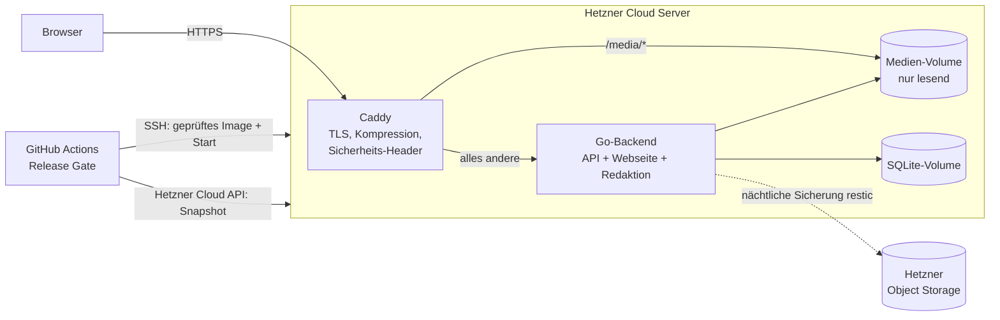

# Architektur – KI Perspektiven

> **Stand:** 2026-11-17 · Repository [MarvinJakob/KIPerspektiven](https://github.com/MarvinJakob/KIPerspektiven) (Nachfolger von `MarvinJakob/AIPerspectives` und `MarvinJakob/aiboard`) · [Board](https://github.com/users/MarvinJakob/projects/4) · Arbeitsweise der Agenten: [AGENTS.md](AGENTS.md) und je Rolle [Analyst](AGENTS_ANALYST.md), [Tester](AGENTS_TESTER.md), [Fixer](AGENTS_FIXER.md), [Reviewer](AGENTS_REVIEWER.md)

Dieses Dokument beschreibt den Aufbau der Anwendung (Abschnitte 1–4) und ihrer Umgebung: Tests, Entwicklung mit parallelen Agenten, GitHub, Auslieferung und Betrieb auf Hetzner (Abschnitte 5–10). Begründungen wichtiger Entscheidungen stehen in den ADRs unter [app/docs/adr](app/docs/adr).

---

## 1 Überblick

AI Perspectives ist eine öffentliche, zweisprachige Webseite (DE/EN) mit Themenseiten, Blog, KI-Readiness-Selbsteinschätzung und Beratungsanfrage sowie einem Redaktionsbereich für Beiträge, Medien, Konten, Statistik und Anfragen.

| Bereich | Technologie |
|---|---|
| Frontends | Öffentliche Webseite und Redaktion, je React + TypeScript + Vite |
| Backend | Go (`net/http`), liefert API und beide Frontends aus einem Binary aus |
| Schnittstelle | `app/api/openapi.yaml` als verbindlicher Vertrag, Code für Go und TypeScript daraus erzeugt |
| Datenbank | SQLite (WAL) im Docker-Volume, Migrationen mit goose |
| Betrieb | Docker Compose (Caddy + Backend) auf einem Hetzner-Cloud-Server |
| Qualität | Image-Build im Merge Gate, Healthchecks bei der Installation |
| Auslieferung | GitHub Actions: Merge Gate je PR, Release Gate automatisch nach Push/Merge auf `main` |



**Grundprinzipien**

- **Einfach.** Ein Server, zwei Container, eine Datei als Datenbank. Neue Komponenten erst bei Bedarf.
- **Sicherheit im Backend.** Sichtbarkeit von Beiträgen, Rollen und Zugriffe entscheidet nur das Backend.
- **Jede Ansicht hat eine echte URL** und liefert beim ersten Aufruf passende Meta-Tags.
- **Keine Daten an Dritte.** Keine externen Schriften, Skripte, CDNs oder Tracker; die Content-Security-Policy erzwingt das.
- **Anforderungen sind prüfbar.** Jede Anforderung hat nummerierte Akzeptanzkriterien.

---

## 2 Repository

```
/
├── AGENTS.md              gemeinsame Arbeitsweise aller Agenten (CLAUDE.md verweist darauf)
├── AGENTS_<ROLLE>.md      Ablauf je Rolle: ANALYST (Team 1), TESTER (Team 2), FIXER (Team 3), REVIEWER (Team 4)
├── ARCHITECTURE.md        dieses Dokument
├── app/                   Anwendung (einziger Teil, der ausgeliefert wird)
│   ├── api/openapi.yaml   Schnittstellenvertrag
│   ├── frontend/          Öffentliche Webseite (React, Vite)
│   ├── frontend-redaktion/ Redaktionsfrontend, Basispfad /redaktion
│   ├── backend/           Go-Modul: cmd/server, internal/*, migrations/
│   ├── deploy/            Caddyfile, deploy.sh, backup/
│   ├── docs/              Betrieb, ADRs, Abnahmeprotokolle
│   ├── Dockerfile         baut beide Frontends und das Backend zu einem Image
│   ├── compose.yaml       Produktion; compose.dev.yaml für lokal
│   └── .env.example       Vorlage für die Server-.env
├── tools/                 task.sh (Aufgaben-Sperre), board.sh (Projektstatus), work.sh (Warteschlange, Betriebssteuerung),
│                          reconcile.mjs (Prozessabgleich), review.mjs (Review-Nachweis), Prüfungen des Merge Gate
├── .github/               Workflows, Composite Actions, Issue- und PR-Vorlagen
├── content/
│   ├── topics/<Thema>/    Quelltexte der Seiteninhalte (audit, data, home, persona, process, software,
│   │                      understanding); Frontend-Tests gleichen die veröffentlichten Texte damit ab
│   ├── improvements.md    Befunde aus Nutzertests (Verbesserungen)
│   ├── new_functions.md   Vorschläge für neue Funktionen
│   ├── research/          Recherchen (JJJJ-MM-TT Titel.md)
│   ├── presentation/ output/  Präsentation, Druckvorlagen
│   └── archive/           nur lokal (.gitignore): alte Agenten-Vorgaben, nicht mehr gültig
├── res/                   Grafiken und Profilbilder (Quellen)
├── mock/                  statische Design-Entwürfe
└── requirements/          Ablage für Anforderungen (maßgeblich sind die Issues mit Label requirement)
```

**Nicht ins Repository** (`.gitignore`, das Repository ist öffentlich): Zugangsdaten und Schlüssel, `.env`, Datenbanken, Medien, Build-Artefakte, Testberichte, Worktrees (`.worktrees/`) und lokale Einstellungen der Werkzeuge. Erzeugter Code aus `openapi.yaml` und SQL wird eingecheckt.

---

## 3 Anwendung

### Frontends

Zwei eigenständige React-Anwendungen unter derselben Domain, beide mit derselben Go-API.

| Aspekt | Entscheidung |
|---|---|
| Sprache, Build | TypeScript `strict`, Vite; das Backend bettet die Builds per `go:embed` ein |
| Routing | React Router, öffentliche Routen mit Sprachpräfix `/:lang/…` (`de`, `en`), Redaktion unter `/redaktion/…` |
| Daten | typisierter Client mit openapi-fetch, TanStack Query |
| Texte | i18next; Beitragsinhalte als Markdown ohne rohes HTML |
| Gestaltung | CSS mit Design-Tokens, selbst gehostete Schriften, heller und dunkler Modus |

Öffentliche Ansichten: Startseite, Themenseiten, KI verstehen, KI-Readiness mit Auswertung und Beratungsanfrage, Blog, Impressum, Datenschutz. Redaktion: Anmeldung, Beiträge (inkl. geplanter Veröffentlichung), Medien, Benutzer (`admin`), Statistik und Beratungsanfragen (`editor`, `admin`).

### Backend

| Aspekt | Entscheidung |
|---|---|
| HTTP | Standardbibliothek `net/http`, API-Interface aus `openapi.yaml` (oapi-codegen) |
| Daten | SQLite mit `modernc.org/sqlite` (ohne CGO), Abfragen typsicher mit sqlc, Store hinter Interface |
| Migrationen | goose, eingebettet, laufen beim Start; nur additiv (Rollback-fähig) |
| Konfiguration | Umgebungsvariablen, siehe [app/.env.example](app/.env.example) |
| Logging | `log/slog` als JSON, ohne IP-Adressen und Anfrageinhalte |
| Befehle | `server` (Start), `server user create`, `server healthcheck`, `server backup` |

Schichten in `app/backend/internal`: `http` (Handler, Middleware), `api` (erzeugt), `web` (Auslieferung, Meta-Tags, Sitemap), `service` (Fachlogik), `store` (Datenzugriff, erzeugt), `auth` (Argon2id, Sitzungen), `media` (Bildprüfung, Varianten), `audit`, `clientip`, `statisticskey`.

**Sicherheit:** Sitzungs-Cookies (`HttpOnly`, `Secure`, `SameSite=Lax`) statt JWT, CSRF-Token für schreibende Aufrufe, Rollen `editor`/`admin`, Begrenzung der Anmeldeversuche und Beratungsanfragen je IP im Arbeitsspeicher, Client-IP nur von der festen Caddy-Adresse (`TRUSTED_PROXIES`). Sicherheits-Header setzt Caddy.

### Schnittstelle

`app/api/openapi.yaml` ist die einzige verbindliche Beschreibung; Änderungen beginnen dort und werden mit `make generate` (bzw. den Einzelbefehlen in [app/README.md](app/README.md)) für Go und TypeScript erzeugt. Alle Endpunkte liegen unter `/api`: öffentlich (Themen, Beiträge, Health, Readiness-Ergebnisse, Beratungsanfragen), Anmeldung (`/api/auth/*`) und Redaktion (`/api/admin/*`, Rollenprüfung im Backend; `401` ohne Sitzung, `403` ohne Rolle).

### Seitenauslieferung

Das Backend rendert die öffentliche `index.html` als Template mit Titel, Beschreibung, Open-Graph-Tags, Canonical und `hreflang` passend zur URL; unbekannte Pfade und Entwürfe liefern `404`. Assets mit Hash sind ein Jahr cachebar, `index.html` hat `no-cache`, Redaktionsseiten `no-store` und `noindex`. `/sitemap.xml` und `/robots.txt` erzeugt das Backend.

---

## 4 Daten

| Daten | Ablage |
|---|---|
| Beiträge, Themen, Übersetzungen, Konten, Sitzungen | SQLite `/data/db/app.db` im Volume `app_db` |
| Bilder (neu kodiert, ohne Metadaten, Varianten 480/960/1600/og) | Volume `app_media`, von Caddy nur lesend unter `/media/*` ausgeliefert |
| Statistik | Tagesaggregate und HMAC-Pseudonyme der IP, Schlüssel getrennt von der Datenbank ([ADR 0010](app/docs/adr/0010-statistik-ohne-kennung-und-einwilligung.md)) |
| Readiness-Ergebnisse | nur mit Einwilligung, ohne Personenbezug |
| Beratungsanfragen | E-Mail, Sprache, Zeitpunkt; Löschung durch die Redaktion ([ADR 0011](app/docs/adr/0011-beratungsanfragen-in-der-redaktion.md)) |
| Audit-Inhalte | Datei im Repository (`internal/audit/content.json`) |

Einstellungen: `journal_mode=WAL`, `foreign_keys=ON`, `busy_timeout=5000`. Ein Wechsel zu PostgreSQL ist durch Store-Interface und goose vorbereitet ([ADR 0003](app/docs/adr/0003-sqlite-als-erste-datenbank.md)).

---

## 5 Spezifikationen

Akzeptanzkriterien stehen im Ticket und tragen stabile IDs `REQ-<n>-AC<m>`. Das Repository enthält keine automatisierten Tests; das Merge Gate baut das Image, die Installation prüft Docker- und HTTPS-Healthcheck.

---

## 6 Entwicklungsumgebung mit parallelen Agenten

Mehrere Agenten (Claude Code, Codex u. a.) arbeiten gleichzeitig auf einem Windows-Gerät im OneDrive-Ordner des Projekts. Die Trennung entsteht ohne Abstimmung zwischen den Agenten:

| Mechanismus | Wirkung |
|---|---|
| `tools/task.sh claim <team> <n>` | legt Branch `<team>/<n>` und Worktree `.worktrees/<team>-<n>` aus `origin/main` an; `git worktree add -b` ist atomar, ein zweiter Agent erhält Exitcode 2 |
| Label `in-progress` | bezeichnet aktive Belegung; Boardstatus `In Progress` kann auch eine freigegebene Aufgabe zur Wiederaufnahme bezeichnen |
| `tools/task.sh pause` / `resume` | erhält Branch und Worktree für Übergaben; atomare Übernahme nur freigegebener Aufgaben mit eindeutiger Agentensitzungs-ID |
| Board `Blocked` | konkrete Rückfrage im Issue; nach Antwort und Rückkehr nach `In Progress` übernimmt ein freier Agent |
| Board `Review` | ein anderer, an der Implementierung unbeteiligter Agent prüft den aktuellen Commit; IDs und Commit stehen im PR |
| Chat-Aufträge `Team 4`, `Reviewer`, `review` | eine unabhängige Sitzung bearbeitet genau eine PR-Abnahme oder Release-Auswertung; [AGENTS_REVIEWER.md](AGENTS_REVIEWER.md) |
| Branch-Präfix `spec/`, `verify/`, `fix/` | das Merge Gate prüft die Team-Grenzen (welche Dateien geändert werden dürfen) |
| `tools/task.sh claim maint <n>` | nur bei ausdrücklichem Wartungsauftrag: Branch `codex/maint-<n>`, Worktree `.worktrees/maint-<n>`; unabhängiges Review und Merge Gate bleiben Pflicht |
| Port `20000 + <n>`, Datenbank in `app/.build/` des Worktrees | lokale Server der Agenten stören sich nicht |
| Squash-Merge, Branch-Löschung nach Merge | `main` bleibt linear, Sperren verschwinden mit `tools/task.sh finish` |

**Zugang:** `GH_TOKEN` (GitHub, Scopes `repo`, `workflow`, `project`) als Windows-Benutzervariable. Hetzner-Zugänge gibt es lokal nicht; sie liegen ausschließlich als GitHub-Secrets vor (siehe [Secrets und Variablen](#secrets-und-variablen)). Werkzeuge: Git (mit Git Bash), GitHub CLI, Go (Version aus `app/backend/go.mod`), Node 24.

### Vier-Team-Prozess

Die aktuellen Vorgaben des Maintainers in AGENTS.md gelten auch gegenüber älteren Prozessgrafiken: Team 1 spezifiziert und schreibt Tests; Team 2 validiert Feature-Teilläufe und schreibt Feature-/Bug-Tickets; Team 3 implementiert und behebt auch Testdefekte; Team 4 reviewed und wertet vollständige Release-Tests aus. Nur Team 2 ergänzt die Baseline. Neue offene `feature`-Tickets sind Implementierungsaufträge, `works` dokumentiert nachgewiesene Funktionen. Historische geschlossene Erfolgs-Tickets bleiben erhalten.

---

## 7 Auslieferung

### GitHub

| Element | Zweck |
|---|---|
| Branch `main` | Integrationsstand („Code Stream“), nur über PR mit grünem Merge Gate |
| Branch `release` | historischer Release-Stand; wird von der vereinfachten Pipeline nicht fortgeschrieben |
| Team-Branches | `spec/<n>`, `verify/<n>`, `fix/<n>`, kurzlebig |
| Image-Version `<Commit>-<Image>` | identifiziert die installierte Version |
| Projekt „KI Perspektiven“ ([Board](https://github.com/users/MarvinJakob/projects/4)) | Feld Status mit den Spalten Backlog, Spezifiziert, In Arbeit, Merge Gate, Bug offen, Funktioniert; zusätzlich Priority und Size |
| Labels | `requirement`, `needs-analysis`, `specified`, `done`, `bug`, `feature`, `works`, `test-defect`, `release-blocker`, `release-failure`, `release-review`, `maintenance`, `maintenance-approved`, `in-progress`, `blocked`, `waiting-for-test` |

Branch-Schutz für `main`: Pull Request und Statusprüfung `Merge Gate` sind verpflichtend, der Branch muss vor Merge aktuell sein. Die Regel gilt auch für Administratoren; Force-Push und Branch-Löschung sind gesperrt.

### Workflows

| Workflow | Auslöser | Inhalt |
|---|---|---|
| [merge-gate.yml](.github/workflows/merge-gate.yml) | PR nach `main`, Push auf `main`, manuell | Image-Build → Installation auf `main` |
| [rollback.yml](.github/workflows/rollback.yml) | manuell | vorherige oder angegebene Version starten |
| [deploy-access.yml](.github/workflows/deploy-access.yml) | manuell | Hetzner-API und SSH lesend prüfen |

### Build und Installation

Der Pflichtcheck `Merge Gate` baut das Docker-Image. Ein fehlerhafter Build lässt den Pflichtcheck fehlschlagen.

Pull Requests installieren keine Version. Nach einem Push/Merge auf `main` läuft derselbe Build; anschließend wird genau das gebaute Image als Actions-Artefakt nach Hetzner übertragen und aktiviert. Die Version enthält Commit- und Image-ID. `deploy.sh` prüft Image-ID und Commit-Label, wartet auf Docker-Healthcheck und HTTPS-Healthcheck und stellt bei fehlgeschlagenem Start die bisherige Version wieder her. Laufende Installationen und Rollbacks teilen `release-production` als Sperre und werden nicht abgebrochen. Die fünf jüngsten Versionen bleiben für Rollbacks verfügbar.

Team-Grenzen, Review-Checklisten, Issue-Blocker, Release-Branch, GitHub-Release-Veröffentlichung und Snapshot sind keine zusätzlichen Pipeline-Schritte. Die bisherigen Workflows für Release Gate, Prozessabgleich, Feature-Fixes und Release-Nacharbeit entfallen. Manueller Neustart auf `main`: `gh workflow run merge-gate.yml --ref main`.

### Secrets und Variablen

Unter *Settings → Secrets and variables → Actions*, Umgebung `production` (Deployments nur von `main`):

| Name | Art | Inhalt |
|---|---|---|
| `DEPLOY_HOST` | Secret | SSH-Ziel, z. B. `root@<Server-IP>` |
| `HETZNER_SSH` | Secret | privater Deploy-Schlüssel |
| `DEPLOY_KNOWN_HOSTS` | Secret | geprüfte Host-Schlüssel des Servers |
| `DEPLOY_URL` | Variable | öffentliche Adresse, z. B. `https://marvinjakob.de` |

Eine Registry ist nicht nötig. `HETZNER_API` und `HCLOUD_SERVER_NAME` werden nur noch für den manuellen Zugangstest verwendet; die automatische Installation benötigt keinen API-Token und erzeugt keinen Snapshot. Deployment-Schlüssel bleiben in GitHub Actions.

### Worker-Betrieb

Implementierte Tickets warten im Merge Gate, solange über `Feature-Ticket: #<Ursprungsticket>` zugeordnete Bugs offen sind. Bugs bleiben getrennte Team-3-Aufgaben mit eigenem PR und unabhängigem Review. Nach dem letzten abgeschlossenen Fix wird das abschließende Feature-Review für einen neuen Team-4-Agenten im laufenden Supervisor freigegeben. Es umfasst alle zugeordneten Fix-PRs im aktuellen Feature-Head. `feature-links.mjs` prüft den Fix-Satz, Commit-Abstammung und Unabhängigkeit; `review.mjs` bindet den Nachweis an den gesamten Fix-Satz. Issue-Ereignisse (`feature-fixes.yml`) prüfen betroffene Gates erneut, `merge.mjs` prüft die Live-Abhängigkeiten direkt vor dem Merge. Details: `AGENTS.md`, „Feature mit zugeordneten Bugs“. Der anschließende Merge auf `main` startet Tests, Build und Installation. Die früheren Prozessprüfungen sind nicht mehr Teil der GitHub Actions.

`tools/work.sh` lädt den aktuellen Prozess aus `origin/main` in einen eigenen unveränderlichen Checkout. `--check` prüft Zugänge/Werkzeuge und zeigt die Warteschlange, `--once` startet eine frische Sitzung, `--watch` überwacht neue Arbeit. `tools/work-watch.ps1` lädt unter Windows bei geändertem `main` automatisch den neuen Prozess. Wartung benötigt `maintenance` und `maintenance-approved`. Fehler stoppen den Supervisor; abgestürzte Besitzer werden nur nach explizitem Maintainer-Nachweis freigegeben. Lebenszeichen und Operationssperren zeigt `task.sh status`.

`tools/reconcile.mjs --apply --board` repariert unterbrochene Übergaben anhand eingecheckter Spezifikationen und Baseline; es verändert keine fremden Arbeitsdateien oder lokalen Sperren. `test-defect.mjs` trennt Testkorrekturen von wartenden Bugs. Reviews werden mit `review.mjs` aus der unabhängigen Sitzung als GitHub-Review für den konkreten Commit dokumentiert und vom Gate verifiziert. Einzelheiten und Befehle: [AGENTS.md](AGENTS.md) und [AGENTS_REVIEWER.md](AGENTS_REVIEWER.md).

---

## 8 Betrieb auf Hetzner

| Baustein | Stand |
|---|---|
| Server | Hetzner-Cloud-Server `KI-Perspektiven-PRD` (2 GB RAM + 2 GB Swap, containerd-Image-Store), Ubuntu, Docker Engine mit Compose-Plugin; Domain `marvinjakob.de` |
| Verzeichnis | `/opt/ki-web`: `.env`, aktive `compose.yaml` und `deploy/Caddyfile`, `build/<Version>/` |
| Container | `caddy` (`caddy:2-alpine`, Ports 80/443, Let's Encrypt, Header, `/media`) und `backend` (`ki-web:<Version>`, distroless, nur intern, feste Proxy-IP `172.30.142.2`) |
| Volumes | `app_db`, `app_media`, `caddy_data` – bleiben bei Deployments erhalten |
| Firewall | Hetzner Cloud Firewall: eingehend nur 22 (nur Schlüssel), 80, 443 |
| Health | Docker-Healthcheck `/server healthcheck`, `restart: unless-stopped`, von außen `/api/health` |
| Sicherung | nächtlich `deploy/backup/backup.sh`: `server backup` (VACUUM INTO) und restic nach Hetzner Object Storage, 30 Tage; keine automatischen Snapshots durch die Deployment-Pipeline |
| Logs | Docker: 5 × 10 MB je Container; Caddy kürzt IP-Adressen und löscht nach 7 Tagen |
| Wartung | `unattended-upgrades`; Abhängigkeiten über PRs durch das Merge Gate |

Ersteinrichtung, `.env`, Domainwechsel, Wiederherstellung und Logs: [app/docs/betrieb.md](app/docs/betrieb.md).

---

## 9 Datenschutz

Keine Cookies für Besucher außer bei Anmeldung zur Redaktion, keine Einbindung Dritter, Reichweitenmessung nur serverseitig ohne Kennung ([ADR 0010](app/docs/adr/0010-statistik-ohne-kennung-und-einwilligung.md)), Readiness-Ergebnisse nur mit Einwilligung, Bilder ohne Metadaten, Sicherungen verschlüsselt in Deutschland. Auftragsverarbeitungsvertrag mit Hetzner. Die Entwicklungsumgebung verwendet nur Testdaten (`DEV_SEED`, `@example.test`).

---

## 10 Architekturentscheidungen

ADRs nach Michael Nygard (Status, Kontext, Entscheidung, Konsequenzen) in [app/docs/adr](app/docs/adr), fortlaufend nummeriert. Ein ADR ist nötig, wenn eine Entscheidung schwer umkehrbar ist, mehrere Teile betrifft oder es ernsthafte Alternativen gab. Angenommene ADRs werden nicht geändert, sondern durch neue ersetzt.

| Nr. | Entscheidung |
|---|---|
| 0001 | Architekturentscheidungen als ADRs |
| 0002 | Ein Repository für Frontend, Backend und Betrieb |
| 0003 | SQLite als erste Datenbank |
| 0004 | Go-Backend liefert die React-Apps aus und setzt Meta-Tags |
| 0005 | Sitzungs-Cookies statt JWT |
| 0006 | OpenAPI als Vertrag |
| 0007 | Docker Compose auf Hetzner |
| 0008 | Medien im Docker-Volume |
| 0009 | Audit-Inhalte als Datei im Repository |
| 0010 | Statistik ohne Kennung und Einwilligung |
| 0011 | Beratungsanfragen in der Redaktion |
