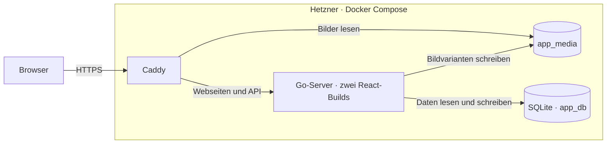

# Architektur von KI Perspektiven

KI Perspektiven ist eine zweisprachige Website mit Themenseiten, Blog und KI-Readiness-Selbsteinschätzung. Über dieselbe Domain pflegt die Redaktion Beiträge, liest Anfragen und verwaltet Konten. Beide Oberflächen werden mit der Go-API als ein Docker-Image ausgeliefert. SQLite und hochgeladene Bilder liegen in separaten Docker-Volumes.

Grundlage ist der Repository-Stand `origin/main` (`4eb20d6d7059`, lokal vorliegende Referenz vom 18. November 2026). Der lokale Checkout (`cb9a70a663d0`) enthält die später ergänzten Playwright-Tests, die Änderung an SQLite-Schreibtransaktionen und den Kurzcheck auf der Startseite noch nicht.

## 1 Laufzeitarchitektur

Caddy terminiert HTTPS, setzt Sicherheitsheader und leitet Seiten- und API-Aufrufe an `backend:8080` im internen Compose-Netz. Für `/media/*` liest Caddy direkt aus dem schreibgeschützt eingebundenen Medien-Volume. Das Backend akzeptiert weitergeleitete Client-IP-Adressen von der fest konfigurierten Caddy-Adresse. [Compose-Konfiguration](app/compose.yaml) · [Caddyfile](app/deploy/Caddyfile)

## 2 Komponenten

| Komponente | Verantwortung |
|---|---|
| [Öffentliche Website](app/frontend/src) | React und TypeScript für Themen, Blog, Readiness und Kontakt. UI-Texte und ausgewählte redaktionelle Seiteninhalte sind im Frontend versioniert. |
| [Redaktion](app/frontend-redaktion/src) | Eigene React-Anwendung zur Beitrags- und Bildpflege sowie für Kontakt- und Beratungsanfragen, Statistik und Konten. |
| [HTTP- und Web-Schicht](app/backend/internal/http) | API, Zugriffsschutz und Anbindung der [Web-Auslieferung](app/backend/internal/web). Die Web-Schicht liefert die eingebetteten Frontends, HTML-Metadaten, Sitemap und `robots.txt`. |
| [Go-Fachdienste](app/backend/internal/service) | Regeln für Veröffentlichungen, Konten, Anfragen und Statistik. Die Dienste verwenden die generierten SQLite-Abfragen aus dem [Store-Paket](app/backend/internal/store). |
| [Server-Einstiegspunkt](app/backend/cmd/server/main.go) | Lädt Konfiguration und Migrationen, startet HTTP und führt Hintergrundaufgaben für geplante Veröffentlichungen und abgelaufene Sitzungen aus. |

## 3 Routen und Auslieferung

| Pfad | Zuständigkeit |
|---|---|
| `/de`, `/en` und ihre Unterseiten | Der Go-Server ermittelt Statuscode, Sprache und Metadaten für die erste HTML-Antwort. Danach übernimmt React die Navigation. Unveröffentlichte Beiträge liefern öffentlich `404` und fehlen in der Sitemap. [Seitenauflösung](app/backend/internal/web/site.go) · [Sitemap](app/backend/internal/web/sitemap.go) |
| `/redaktion` und Unterseiten | Der Go-Server prüft beim direkten Seitenaufruf die zur Route passende Berechtigung. Die Anmeldung liegt unter `/redaktion/anmelden`. [Redaktionsrouten](app/backend/internal/web/editorial.go) |
| `/api/*` | Die Go-API bedient beide Frontends auf derselben Herkunft. Öffentliche, sitzungsbezogene und redaktionelle Endpunkte sind im API-Vertrag beschrieben. [OpenAPI](app/api/openapi.yaml) |

## 4 Sitzungen und Berechtigungen

`POST /api/auth/login` erstellt eine serverseitige Sitzung. Der Browser erhält den zufälligen Sitzungsschlüssel als `HttpOnly`-Cookie mit `SameSite=Lax` und bei HTTPS mit `Secure`. In SQLite liegt nur der Hash des Schlüssels. Die Sitzung gilt zwölf Stunden. Die Abmeldung und die Deaktivierung eines Kontos machen die betroffenen Sitzungen serverseitig ungültig. [HTTP-Zugriffsschutz](app/backend/internal/http/auth.go) · [Kontendienst](app/backend/internal/service/accounts.go)

Redaktionelle Endpunkte unter `/api/admin/*` verlangen eine gültige Sitzung und eine passende Rolle (Ticket #64): Beiträge `editor` oder `admin`, lesender Zugriff auf Statistik, Nachrichten und Beratungsanfragen `marketing` oder `admin`, Löschen von Beratungsanfragen und Benutzerverwaltung nur `admin`. Ein Konto kann mehrere Rollen haben. Das eigene Profil unter `/api/profile*` steht jeder gültigen Sitzung offen. Bei schreibenden geschützten Aufrufen prüft das Backend zusätzlich `X-CSRF-Token`. Schreibende API-Aufrufe fremder Herkunft werden abgewiesen. `REQUIRE_LOGIN` steuert einen optionalen Zugangsschutz für die öffentliche Website. [API-Schutz](app/backend/internal/http/auth.go) · [Optionaler Zugangsschutz](app/backend/internal/http/gate.go)

## 5 Schnittstellen und Datenflüsse

Änderungen am API-Vertrag beginnen in `app/api/openapi.yaml`. `make generate` im Verzeichnis `app` aktualisiert Go-Schnittstellen und die TypeScript-Typen beider Frontends. Der gleiche Befehl erzeugt mit sqlc die Go-Implementierung der SQL-Abfragen. [OpenAPI-Vertrag](app/api/openapi.yaml) · [Makefile](app/Makefile) · [SQL-Abfragen](app/backend/internal/store/queries.sql)

- **Beiträge.** Die Redaktion speichert Entwürfe in SQLite. Beim Veröffentlichen prüft der Fachdienst die benötigten Inhalte. Ein Hintergrundlauf veröffentlicht fällige Beiträge. Öffentliche Seiten und API lesen den veröffentlichten Bestand. [Redaktionsdienst](app/backend/internal/service/editorial.go) · [Öffentlicher Dienst](app/backend/internal/service/public.go)
- **Kontakt.** `POST /api/contact-messages` validiert die Eingaben und speichert gültige Nachrichten mit Sprache und Eingangszeit. Die Redaktion liest den Posteingang über `GET /api/admin/contact-messages`. [Kontaktdienst](app/backend/internal/service/contact.go) · [OpenAPI-Vertrag](app/api/openapi.yaml)
- **Readiness und Beratung.** Der Kurzcheck auf der Startseite hält seine Antworten im Arbeitsspeicher des Browsers. Die ausführliche Selbsteinschätzung berechnet ihre Auswertung ebenfalls im Browser und überträgt vollständige Ergebnisse für die Statistik mit Einwilligung. Eine zufällige Kennung im Arbeitsspeicher des Browsers ermöglicht Aktualisierung und Widerruf. Beratungsanfragen verwenden einen eigenen Endpunkt und speichern E-Mail-Adresse und Sprache ohne Verknüpfung zum Ergebnis. [Startseite](app/frontend/src/pages/Home.tsx) · [Readiness-Frontend](app/frontend/src/lib/assessment.tsx) · [Beratungsdienst](app/backend/internal/service/consultations.go)

## 6 Build und Prüfung

Der Docker-Build kompiliert beide React-Anwendungen mit Vite und bettet ihre Ausgaben in das Go-Binary ein. Das Laufzeitimage startet den Server als unprivilegierter Benutzer. Für die lokale Entwicklung sind Build und Start mit Testdaten in der Anwendungs-README beschrieben. [Dockerfile](app/Dockerfile) · [Anwendungs-README](app/README.md)

Die Prüfung erfolgt zweistufig. Beide Stufen nutzen dieselben Testjobs. Sie prüfen Prozesswerkzeuge mit `node --test` und Go-Pakete mit `go test`. Für Frontends mit `test:unit` laufen Typprüfung und Unit-Tests. Playwright prüft API und Browser gegen das gebaute Image mit Testdaten. Der Image-Build selbst führt keine Tests aus. [Testjobs](.github/workflows/tests.yml) · [Entwicklungsprozess](AGENTS.md)

- **Merge Gate.** Läuft für jeden Pull Request nach `main`. Der Job „Testauswahl“ ordnet die geänderten Dateien über Importgraph, Go-Paketabhängigkeiten und die Abdeckungszeilen der Playwright-Specs den betroffenen Tests zu. Gemeinsam genutzte Module betreffen alle abhängigen Tests. Dateien ohne Zuordnungsregel lassen den Check scheitern; Änderungen an Pipeline oder Testauswahl prüfen die vollständige Suite. Der Abschlussjob `Merge Gate` ist der vom Branch-Schutz verlangte Pflichtcheck für einen aktuellen PR-Branch. Er veröffentlicht den Nachweis für den geprüften Git-Tree. [Merge Gate](.github/workflows/merge-gate.yml) · [Testauswahl](tools/affected-tests.mjs)
- **Release Gate.** Läuft nach jedem Push auf `main` und auf Anforderung. Es vermerkt die Übergabe im referenzierten Ticket und führt die vollständige Suite aus. Erst danach installiert es das geprüfte Image. [Release Gate](.github/workflows/release-gate.yml) · [Ticketübergabe](tools/release-handover.mjs)

## 7 Auslieferung

Der Installationsjob des Release Gates startet erst nach erfolgreicher vollständiger Suite. Er übernimmt das im selben Lauf getestete Image als Artefakt. Vor der Installation gleicht er den gebauten Commit mit der Spitze von `main` ab. Unmittelbar vor der Installation prüft der Job offene Release-Blocker und ihre Nachweise für diesen Git-Tree. Das Deploymentskript überträgt das Image per SSH und prüft dessen ID und Commit-Label auf dem Zielserver. Die Versionskennung enthält jeweils einen Präfix von Commit-SHA und Image-ID. Die Zusammenfassung des Laufs nennt Commit, Testergebnis und installierte Version. [Release Gate](.github/workflows/release-gate.yml) · [Deploymentskript](app/deploy/deploy.sh)

Docker Compose wartet auf den internen Healthcheck. Anschließend ruft das Deploymentskript `/api/health` über die öffentliche HTTPS-Adresse auf. Der Endpunkt prüft, ob SQLite erreichbar ist. Bei fehlgeschlagener Installation stellt der Workflow die bisherige Version wieder her, sofern eine vorhanden ist. Automatische Installation und manueller Rollback verwenden dieselbe GitHub-Actions-Sperre. [Health-Endpunkt](app/backend/internal/http/api.go) · [Deploymentskript](app/deploy/deploy.sh) · [Rollback-Workflow](.github/workflows/rollback.yml)

## 8 Betrieb auf Hetzner

| Daten | Speicher und Lebenszyklus |
|---|---|
| Themen, Beiträge und Übersetzungen, Konten und Sitzungen, Anfragen und Statistik | SQLite unter `/data/db/app.db` im Volume `app_db`. Die Daten überdauern den Austausch des Anwendungscontainers. |
| Hochgeladene Titelbilder | Das Backend validiert Uploads und schreibt Bildvarianten in `app_media`. Caddy liefert die Dateien aus demselben Volume aus. |
| Readiness-Katalog | Die [JSON-Datei im Backend](app/backend/internal/audit/content.json) wird versioniert und ins Server-Binary eingebettet. |
| Statistikschlüssel | Separate Datei im Datenbank-Volume für HMAC-Pseudonyme der Seitenstatistik. Der Schlüssel wird getrennt von der Datenbankkopie gesichert. |
| Caddy-Zertifikate und Zugriffsprotokolle | Volume `caddy_data`. |

SQLite verwendet WAL, Fremdschlüsselprüfung und eine Wartezeit von fünf Sekunden bei belegter Datenbank. Auf `origin/main` ist für schreibende Transaktionen zusätzlich der sofortige Sperrbeginn konfiguriert. Goose führt die eingebetteten Migrationen beim Serverstart aus. Schemaänderungen müssen additiv sein, damit die Vorgängerversion nach einem Rollback mit der migrierten Datenbank arbeiten kann. [SQLite-Konfiguration im lokalen Checkout](app/backend/internal/store/sqlite.go) · [Migrationen](app/backend/migrations) · [Entwicklungsprozess](AGENTS.md)

Ein Versionswechsel tauscht die Anwendung aus und greift auf dieselben Volumes zu. Für die Wiederherstellung von Daten braucht der Betrieb eine konsistente SQLite-Kopie, die Medien und eine gesonderte Sicherung des Statistikschlüssels. `/server backup` erzeugt die SQLite-Kopie mit `VACUUM INTO`. Laut Betriebshandbuch ist die nächtliche Sicherung mit restic vorbereitet und noch nicht eingerichtet. [Betriebshandbuch](app/docs/betrieb.md#sicherung-und-wiederherstellung) · [Backup-Skript](app/deploy/backup/backup.sh)

Die Gründe für die Architekturentscheidungen sind in den [Architecture Decision Records](app/docs/adr) dokumentiert.
