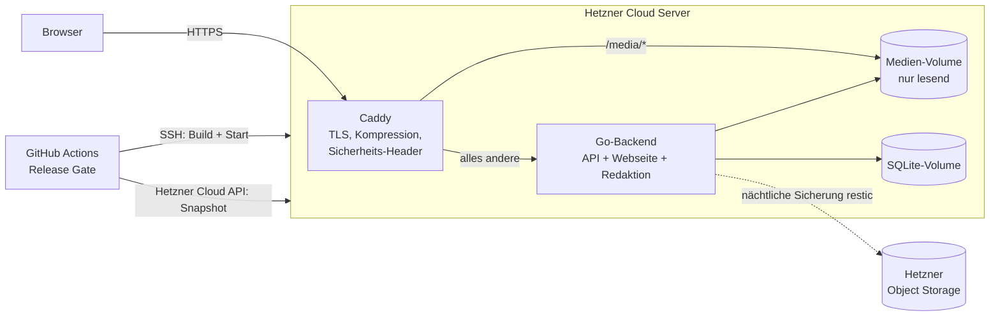
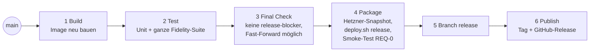

# Architektur – AI Perspectives

> **Stand:** 2026-11-16 · Repository [MarvinJakob/AIPerspectives](https://github.com/MarvinJakob/AIPerspectives) (Nachfolger von `MarvinJakob/aiboard`) · Arbeitsweise der Agenten: [AGENTS.md](AGENTS.md)

Dieses Dokument beschreibt den Aufbau der Anwendung (Abschnitte 1–4) und ihrer Umgebung: Tests, Entwicklung mit parallelen Agenten, GitHub, Auslieferung und Betrieb auf Hetzner (Abschnitte 5–10). Begründungen wichtiger Entscheidungen stehen in den ADRs unter [app/docs/adr](app/docs/adr).

---

## 1 Überblick

AI Perspectives ist eine öffentliche, zweisprachige Webseite (DE/EN) mit Themenseiten, Blog, KI-Readiness-Selbsteinschätzung und Beratungsanfrage sowie einem Redaktionsbereich für Beiträge, Medien, Konten, Statistik und Anfragen.

| Bereich | Technologie |
|---|---|
| Frontends | Öffentliche Webseite und Redaktion, je React + TypeScript + Vite |
| Backend | Go (`net/http`), liefert API und beide Frontends aus einem Binary aus |
| Schnittstelle | `app/api/openapi.yaml` als verbindlicher Vertrag, Code für Go und TypeScript daraus erzeugt |
| Datenbank | SQLite (WAL) im Docker-Volume, Migrationen mit goose |
| Betrieb | Docker Compose (Caddy + Backend) auf einem Hetzner-Cloud-Server |
| Qualität | Unit-Tests (Go, Vitest), Fidelity-Tests (Playwright) gegen die laufende Anwendung |
| Auslieferung | GitHub Actions: Merge Gate je PR, Release Gate automatisch nach Push/Merge auf `main` |



**Grundprinzipien**

- **Einfach.** Ein Server, zwei Container, eine Datei als Datenbank. Neue Komponenten erst bei Bedarf.
- **Sicherheit im Backend.** Sichtbarkeit von Beiträgen, Rollen und Zugriffe entscheidet nur das Backend.
- **Jede Ansicht hat eine echte URL** und liefert beim ersten Aufruf passende Meta-Tags.
- **Keine Daten an Dritte.** Keine externen Schriften, Skripte, CDNs oder Tracker; die Content-Security-Policy erzwingt das.
- **Anforderungen sind ausführbar.** Jede Anforderung hat Fidelity-Tests; was funktioniert, steht in der Baseline und darf nicht mehr kaputtgehen.

---

## 2 Repository

```
/
├── AGENTS.md              Arbeitsweise der Agenten-Teams (CLAUDE.md verweist darauf)
├── ARCHITECTURE.md        dieses Dokument
├── app/                   Anwendung (einziger Teil, der ausgeliefert wird)
│   ├── api/openapi.yaml   Schnittstellenvertrag
│   ├── frontend/          Öffentliche Webseite (React, Vite)
│   ├── frontend-redaktion/ Redaktionsfrontend, Basispfad /redaktion
│   ├── backend/           Go-Modul: cmd/server, internal/*, migrations/
│   ├── deploy/            Caddyfile, deploy.sh, backup/
│   ├── docs/              Betrieb, ADRs, Abnahmeprotokolle
│   ├── Dockerfile         baut beide Frontends und das Backend zu einem Image
│   ├── compose.yaml       Produktion; compose.dev.yaml für lokal
│   └── .env.example       Vorlage für die Server-.env
├── fidelity/              Fidelity-Tests (Abschnitt 5)
├── tools/                 task.sh (Aufgaben-Sperre), board.sh (Projektstatus)
├── .github/               Workflows, Composite Actions, Issue- und PR-Vorlagen
├── content/
│   ├── topics/<Thema>/    Quelltexte der Seiteninhalte (audit, data, home, persona, process, software,
│   │                      understanding); Frontend-Tests gleichen die veröffentlichten Texte damit ab
│   ├── improvements.md    Befunde aus Nutzertests (Verbesserungen)
│   ├── new_functions.md   Vorschläge für neue Funktionen
│   ├── research/          Recherchen (JJJJ-MM-TT Titel.md)
│   ├── presentation/ output/  Präsentation, Druckvorlagen
│   └── archive/           nur lokal (.gitignore): alte Agenten-Vorgaben, nicht mehr gültig
├── res/                   Grafiken und Profilbilder (Quellen)
├── mock/                  statische Design-Entwürfe
└── requirements/          Ablage für Anforderungen (maßgeblich sind die Issues mit Label requirement)
```

**Nicht ins Repository** (`.gitignore`, das Repository ist öffentlich): Zugangsdaten und Schlüssel, `.env`, Datenbanken, Medien, Build-Artefakte, Testberichte, Worktrees (`.worktrees/`) und lokale Einstellungen der Werkzeuge. Erzeugter Code aus `openapi.yaml` und SQL wird eingecheckt.

---

## 3 Anwendung

### Frontends

Zwei eigenständige React-Anwendungen unter derselben Domain, beide mit derselben Go-API.

| Aspekt | Entscheidung |
|---|---|
| Sprache, Build | TypeScript `strict`, Vite; das Backend bettet die Builds per `go:embed` ein |
| Routing | React Router, öffentliche Routen mit Sprachpräfix `/:lang/…` (`de`, `en`), Redaktion unter `/redaktion/…` |
| Daten | typisierter Client mit openapi-fetch, TanStack Query |
| Texte | i18next; Beitragsinhalte als Markdown ohne rohes HTML |
| Gestaltung | CSS mit Design-Tokens, selbst gehostete Schriften, heller und dunkler Modus |
| Tests | Vitest und Testing Library |

Öffentliche Ansichten: Startseite, Themenseiten, KI verstehen, KI-Readiness mit Auswertung und Beratungsanfrage, Blog, Impressum, Datenschutz. Redaktion: Anmeldung, Beiträge (inkl. geplanter Veröffentlichung), Medien, Benutzer (`admin`), Statistik und Beratungsanfragen (`editor`, `admin`).

### Backend

| Aspekt | Entscheidung |
|---|---|
| HTTP | Standardbibliothek `net/http`, API-Interface aus `openapi.yaml` (oapi-codegen) |
| Daten | SQLite mit `modernc.org/sqlite` (ohne CGO), Abfragen typsicher mit sqlc, Store hinter Interface |
| Migrationen | goose, eingebettet, laufen beim Start; nur additiv (Rollback-fähig) |
| Konfiguration | Umgebungsvariablen, siehe [app/.env.example](app/.env.example) |
| Logging | `log/slog` als JSON, ohne IP-Adressen und Anfrageinhalte |
| Befehle | `server` (Start), `server user create`, `server healthcheck`, `server backup` |

Schichten in `app/backend/internal`: `http` (Handler, Middleware), `api` (erzeugt), `web` (Auslieferung, Meta-Tags, Sitemap), `service` (Fachlogik), `store` (Datenzugriff, erzeugt), `auth` (Argon2id, Sitzungen), `media` (Bildprüfung, Varianten), `audit`, `clientip`, `statisticskey`.

**Sicherheit:** Sitzungs-Cookies (`HttpOnly`, `Secure`, `SameSite=Lax`) statt JWT, CSRF-Token für schreibende Aufrufe, Rollen `editor`/`admin`, Begrenzung der Anmeldeversuche und Beratungsanfragen je IP im Arbeitsspeicher, Client-IP nur von der festen Caddy-Adresse (`TRUSTED_PROXIES`). Sicherheits-Header setzt Caddy.

### Schnittstelle

`app/api/openapi.yaml` ist die einzige verbindliche Beschreibung; Änderungen beginnen dort und werden mit `make generate` (bzw. den Einzelbefehlen in [app/README.md](app/README.md)) für Go und TypeScript erzeugt. Alle Endpunkte liegen unter `/api`: öffentlich (Themen, Beiträge, Health, Readiness-Ergebnisse, Beratungsanfragen), Anmeldung (`/api/auth/*`) und Redaktion (`/api/admin/*`, Rollenprüfung im Backend; `401` ohne Sitzung, `403` ohne Rolle).

### Seitenauslieferung

Das Backend rendert die öffentliche `index.html` als Template mit Titel, Beschreibung, Open-Graph-Tags, Canonical und `hreflang` passend zur URL; unbekannte Pfade und Entwürfe liefern `404`. Assets mit Hash sind ein Jahr cachebar, `index.html` hat `no-cache`, Redaktionsseiten `no-store` und `noindex`. `/sitemap.xml` und `/robots.txt` erzeugt das Backend.

---

## 4 Daten

| Daten | Ablage |
|---|---|
| Beiträge, Themen, Übersetzungen, Konten, Sitzungen | SQLite `/data/db/app.db` im Volume `app_db` |
| Bilder (neu kodiert, ohne Metadaten, Varianten 480/960/1600/og) | Volume `app_media`, von Caddy nur lesend unter `/media/*` ausgeliefert |
| Statistik | Tagesaggregate und HMAC-Pseudonyme der IP, Schlüssel getrennt von der Datenbank ([ADR 0010](app/docs/adr/0010-statistik-ohne-kennung-und-einwilligung.md)) |
| Readiness-Ergebnisse | nur mit Einwilligung, ohne Personenbezug |
| Beratungsanfragen | E-Mail, Sprache, Zeitpunkt; Löschung durch die Redaktion ([ADR 0011](app/docs/adr/0011-beratungsanfragen-in-der-redaktion.md)) |
| Audit-Inhalte | Datei im Repository (`internal/audit/content.json`) |

Einstellungen: `journal_mode=WAL`, `foreign_keys=ON`, `busy_timeout=5000`. Ein Wechsel zu PostgreSQL ist durch Store-Interface und goose vorbereitet ([ADR 0003](app/docs/adr/0003-sqlite-als-erste-datenbank.md)).

---

## 5 Fidelity-Tests

Fidelity-Tests prüfen von außen (Browser, HTTP), ob eine Anforderung **vollständig** umgesetzt ist. Sie werden von Team 1 geschrieben und verifiziert und sind unabhängig vom Code, den Team 3 ändert.

```
fidelity/
├── specs/REQ-<n>.md        Akzeptanzkriterien und Szenarien je Anforderung (Issue #<n>), Vorlage _VORLAGE.md
├── tests/REQ-<n>.spec.ts   ein Playwright-Test je Kriterium, Titel beginnt mit REQ-<n>-AC<m>
├── baseline.txt            „Dinge, die funktionieren“: IDs, die bestehen müssen (wächst nur, merge=union)
├── scripts/gate.mjs        Auswertung eines Laufs gegen Baseline und geforderte IDs
└── playwright.config.ts    BASE_URL, Projekte desktop und mobil, JSON-Bericht results.json
```

| Begriff | Bedeutung |
|---|---|
| Backlog | alle Tests in `tests/`; fehlschlagende Tests außerhalb der Baseline sind erlaubt |
| Baseline | bestandene IDs; schlägt eine fehl, ist das eine Regression und sperrt Merge und Release |
| Gate | `node scripts/gate.mjs [--require "<IDs>"] [--inventory inventory.json] [--no-baseline]`; Exitcode 1 bei Regression, fehlender geforderter ID oder ungültigem/unvollständigem Lauf |

CI erzeugt vor der Ausführung mit Playwright ein Inventar der erwarteten Tests. Jede ID muss auf Desktop und Mobil vollständig ausgeführt werden. Globale Fehler, fehlende Tests, Skip und erwartete Fehlschläge sperren das Gate; instabile Ergebnisse gelten nicht als funktionierend. Bekannte fachliche Fehlschläge außerhalb der Baseline bleiben erlaubt. Teilläufe müssen ihre geforderten IDs ausdrücklich nennen. Bericht und Inventar werden gemeinsam als Artefakt aufbewahrt.

`REQ-0` (Healthcheck, Startseite, 404) ist die Grundfunktion und läuft auch als Smoke-Test gegen die Produktion.

---

## 6 Entwicklungsumgebung mit parallelen Agenten

Mehrere Agenten (Claude Code, Codex u. a.) arbeiten gleichzeitig auf einem Windows-Gerät im OneDrive-Ordner des Projekts. Die Trennung entsteht ohne Abstimmung zwischen den Agenten:

| Mechanismus | Wirkung |
|---|---|
| `tools/task.sh claim <team> <n>` | legt Branch `<team>/<n>` und Worktree `.worktrees/<team>-<n>` aus `origin/main` an; `git worktree add -b` ist atomar, ein zweiter Agent erhält Exitcode 2 |
| Label `in-progress` | bezeichnet aktive Belegung; Boardstatus `In Progress` kann auch eine freigegebene Aufgabe zur Wiederaufnahme bezeichnen |
| `tools/task.sh pause` / `resume` | erhält Branch und Worktree für Übergaben; atomare Übernahme nur freigegebener Aufgaben mit eindeutiger Agentensitzungs-ID |
| Board `Blocked` | konkrete Rückfrage im Issue; nach Antwort und Rückkehr nach `In Progress` übernimmt ein freier Agent |
| Board `Review` | ein anderer, an der Implementierung unbeteiligter Agent prüft den aktuellen Commit; IDs und Commit stehen im PR |
| Branch-Präfix `spec/`, `verify/`, `fix/` | das Merge Gate prüft die Team-Grenzen (welche Dateien geändert werden dürfen) |
| `tools/task.sh claim maint <n>` | nur bei ausdrücklichem Wartungsauftrag: Branch `codex/maint-<n>`, Worktree `.worktrees/maint-<n>`; unabhängiges Review und Merge Gate bleiben Pflicht |
| `fidelity/baseline.txt` mit `merge=union` | parallele Ergänzungen der Baseline ohne Merge-Konflikt |
| Port `20000 + <n>`, Datenbank in `app/.build/` des Worktrees | lokale Server der Agenten stören sich nicht |
| Squash-Merge, Branch-Löschung nach Merge | `main` bleibt linear, Sperren verschwinden mit `tools/task.sh finish` |

**Zugang:** `GH_TOKEN` (GitHub, Scopes `repo`, `workflow`, `project`) und `HCLOUD_TOKEN` (Hetzner Cloud, Lesen und Schreiben) als Windows-Benutzervariablen. Werkzeuge: Git (mit Git Bash), GitHub CLI, Go (Version aus `app/backend/go.mod`), Node 24, Playwright mit Chromium.

### Abgleich mit dem Mock `software_development`

Der Auftrag vom 16. November 2026 macht den Text und beide Prozessgrafiken dieses Mocks zur fachlichen Quelle des Entwicklungsprozesses.

| Vorgabe | Umsetzung |
|---|---|
| Analysten schreiben und verifizieren Referenzszenarien einschließlich Sonderfällen und Fehlerbehandlung | Team 1, Spezifikationen und ausführbare Fidelity-Tests mit Gegenprobe |
| Tester prüfen vorhandenen Code und dokumentieren funktionierendes und fehlendes Verhalten | Team 2, vollständiger Testlauf, `works`-/Bug-Tickets und wachsende Baseline |
| Ein Fixer pro Fall, Mindeststandards vor Integration | atomare Aufgabenbelegung, eigener Worktree, Änderungen nur in `app/` und append-only Baseline; Merge Gate mit Build, Review, Security und Fidelity |
| Gesamte Testsuite und Final Check vor Release | Release Gate baut den festgelegten Commit neu, prüft alle Tests und sperrt bei Regressionen oder offenen Release-Blockern |
| Veröffentlichung erst am Ende | Integrations-PRs und `main` sind das gemeinsame Arbeitsrepository. Release-Branch, Tag und GitHub-Release werden erst nach Deployment und verpflichtendem Smoke-Test veröffentlicht. |

Die letzte Vorgabe bezieht sich auf die Veröffentlichung des fertigen Releases. Entwicklungsbranches und verifizierte Tests müssen vorher im gemeinsamen Repository verfügbar sein, damit die drei Teams über Backlog und Tests arbeiten können. Der vom Final Check festgelegte Commit ist der Release-Kandidat; der öffentliche Branch `release` wird erst nach erfolgreicher Produktprüfung aktualisiert.

---

## 7 Auslieferung

### GitHub

| Element | Zweck |
|---|---|
| Branch `main` | Integrationsstand („Code Stream“), nur über PR mit grünem Merge Gate |
| Branch `release` | zuletzt released Stand, nur per Fast-Forward durch das Release Gate |
| Team-Branches | `spec/<n>`, `verify/<n>`, `fix/<n>`, kurzlebig |
| Tags `vJJJJ.MM.TT-<Lauf>` | GitHub-Release je ausgeliefertem Stand |
| Projekt „AI Perspectives“ | Board mit Feld Status einschließlich Ready, In Progress, Review und Blocked; bisherige Namen In Arbeit/Merge Gate werden von den Werkzeugen unterstützt; weitere fachliche Stati bleiben erhalten |
| Labels | `requirement`, `needs-analysis`, `specified`, `done`, `bug`, `works`, `test-defect`, `release-blocker`, `in-progress`, `blocked` |

Branch-Schutz für `main`: Pull Request und Statusprüfung `Merge Gate` sind verpflichtend, der Branch muss vor Merge aktuell sein. Die Regel gilt auch für Administratoren; Force-Push und Branch-Löschung sind gesperrt. Die unabhängige Agentenprüfung wird zusätzlich durch den Review-Nachweis im PR abgesichert.

### Workflows

| Workflow | Auslöser | Inhalt |
|---|---|---|
| [merge-gate.yml](.github/workflows/merge-gate.yml) | PR nach `main` | Team-Grenzen, Build, Unit-Tests, Security, Review-Checkliste, Fidelity; Abschlussjob „Merge Gate“ |
| [fidelity-run.yml](.github/workflows/fidelity-run.yml) | Push auf `main`, manuell | ganze Fidelity-Suite auf `main`, Artefakt `fidelity-main` für Team 2 |
| [release.yml](.github/workflows/release.yml) | Push auf `main`, manuell | Release Gate bis Hetzner und GitHub-Release |
| [rollback.yml](.github/workflows/rollback.yml) | manuell | vorherige oder angegebene Version auf dem Server starten |

Composite Actions: `unit-tests`, `fidelity` (startet das Image oder prüft eine URL, wertet mit `gate.mjs` aus), `ssh-setup`, `hcloud-snapshot`.

### Release Gate



Der Workflow startet nach jedem Push/Merge auf `main`, zusätzlich bleibt der manuelle Start möglich. Ein geschlossenes Ticket ohne Merge löst kein Deployment aus. Automatische Läufe prüfen genau den auslösenden Commit und aktivieren den Snapshot auch ohne manuelle Eingabewerte.

1. **Build:** Das Image wird aus dem auslösenden Commit auf `main` (oder dem manuell gewählten `ref`) neu gebaut.
2. **Test:** ganze Unit-Test-Suite und ganze Fidelity-Suite; jede Baseline-ID muss bestehen.
3. **Final Check:** keine offenen Issues mit `release-blocker`; `release` ist Vorfahre des Commits; ist der Stand schon released, endet der Lauf ohne Deployment.
4. **Package:** Snapshot des Servers über die Hetzner Cloud API (die drei jüngsten bleiben), dann [app/deploy/deploy.sh](app/deploy/deploy.sh) `release <Commit>`: `app/` per `git archive` und SSH nach `/opt/ki-web/build/<Version>`, Image `ki-web:<Version>` auf dem Server bauen, mit `docker compose up --wait` starten, `https://DOMAIN/api/health` prüfen. Ist die neue Version nicht gesund, startet das Skript die bisherige wieder und der Lauf schlägt fehl. Danach REQ-0 gegen `DEPLOY_URL`.
5. **release:** Erst nach erfolgreichem Deployment und verpflichtendem Smoke-Test wird der Branch `release` auf den geprüften Commit vorgezogen. Eine fehlende HTTPS-`DEPLOY_URL` sperrt den Lauf bereits vor dem Deployment. Bei Fehlern bleibt der Branch unverändert; ein erneuter Lauf überspringt das fehlgeschlagene Deployment deshalb nicht.
6. **Publish:** erst ganz am Ende Tag und GitHub-Release mit generierten Release Notes.

Releases und Rollbacks laufen nacheinander (`concurrency: release-production`); ein laufendes Deployment wird nicht durch weitere Merges abgebrochen. Mehrere wartende Releases werden von GitHub zum neuesten wartenden Stand zusammengefasst, der die vorherigen Merges enthält. **Rollback:** Workflow „Rollback“ oder lokal `app/deploy/deploy.sh rollback | switch <Version>`; die fünf jüngsten Versionen liegen auf dem Server. Migrationen sind additiv, damit die vorherige Version mit dem neuen Schema läuft. Weitere Details: [app/docs/betrieb.md](app/docs/betrieb.md).

### Secrets und Variablen

Einzurichten unter *Settings → Secrets and variables → Actions* von `MarvinJakob/AIPerspectives`, Umgebung `production`:

| Name | Art | Inhalt |
|---|---|---|
| `DEPLOY_HOST` | Secret | SSH-Ziel, z. B. `root@<Server-IP>` |
| `HETZNER_CLOUD_SSH` | Secret | privater ed25519-Schlüssel nur für Deployments; öffentlicher Teil in `/root/.ssh/authorized_keys` |
| `DEPLOY_KNOWN_HOSTS` | Secret | Host-Schlüssel des Servers (`ssh-keyscan -t ed25519 <IP>`, Fingerprint abgleichen) |
| `HETZNER_CLOUD_API` | Secret | Hetzner-Cloud-API-Token des Projekts (Lesen und Schreiben) für Snapshots |
| `DEPLOY_URL` | Variable | öffentliche Adresse, z. B. `https://marvinjakob.de` |
| `HCLOUD_SERVER_NAME` | Variable | Name des Servers in der Hetzner Cloud |

Fehlen `HETZNER_CLOUD_API` oder `HCLOUD_SERVER_NAME`, läuft das Release ohne Snapshot mit Warnung. Das Image wird auf dem Server gebaut; eine Container-Registry ist nicht nötig.

---

## 8 Betrieb auf Hetzner

| Baustein | Stand |
|---|---|
| Server | Hetzner-Cloud-Server `docker-ce-ubuntu-2gb-nbg1-1` (Nürnberg, 1 vCPU, 2 GB RAM + 2 GB Swap), Ubuntu, Docker Engine mit Compose-Plugin; Domain `marvinjakob.de` |
| Verzeichnis | `/opt/ki-web`: `.env`, aktive `compose.yaml` und `deploy/Caddyfile`, `build/<Version>/` |
| Container | `caddy` (`caddy:2-alpine`, Ports 80/443, Let's Encrypt, Header, `/media`) und `backend` (`ki-web:<Version>`, distroless, nur intern, feste Proxy-IP `172.30.142.2`) |
| Volumes | `app_db`, `app_media`, `caddy_data` – bleiben bei Deployments erhalten |
| Firewall | Hetzner Cloud Firewall: eingehend nur 22 (nur Schlüssel), 80, 443 |
| Health | Docker-Healthcheck `/server healthcheck`, `restart: unless-stopped`, von außen `/api/health` |
| Sicherung | nächtlich `deploy/backup/backup.sh`: `server backup` (VACUUM INTO) und restic nach Hetzner Object Storage, 30 Tage; zusätzlich Snapshot vor jedem Release |
| Logs | Docker: 5 × 10 MB je Container; Caddy kürzt IP-Adressen und löscht nach 7 Tagen |
| Wartung | `unattended-upgrades`; Abhängigkeiten über PRs durch das Merge Gate |

Ersteinrichtung, `.env`, Domainwechsel, Wiederherstellung und Logs: [app/docs/betrieb.md](app/docs/betrieb.md).

---

## 9 Datenschutz

Keine Cookies für Besucher außer bei Anmeldung zur Redaktion, keine Einbindung Dritter, Reichweitenmessung nur serverseitig ohne Kennung ([ADR 0010](app/docs/adr/0010-statistik-ohne-kennung-und-einwilligung.md)), Readiness-Ergebnisse nur mit Einwilligung, Bilder ohne Metadaten, Sicherungen verschlüsselt in Deutschland. Auftragsverarbeitungsvertrag mit Hetzner. Fidelity-Tests verwenden nur Testdaten (`DEV_SEED`, `@example.test`).

---

## 10 Architekturentscheidungen

ADRs nach Michael Nygard (Status, Kontext, Entscheidung, Konsequenzen) in [app/docs/adr](app/docs/adr), fortlaufend nummeriert. Ein ADR ist nötig, wenn eine Entscheidung schwer umkehrbar ist, mehrere Teile betrifft oder es ernsthafte Alternativen gab. Angenommene ADRs werden nicht geändert, sondern durch neue ersetzt.

| Nr. | Entscheidung |
|---|---|
| 0001 | Architekturentscheidungen als ADRs |
| 0002 | Ein Repository für Frontend, Backend und Betrieb |
| 0003 | SQLite als erste Datenbank |
| 0004 | Go-Backend liefert die React-Apps aus und setzt Meta-Tags |
| 0005 | Sitzungs-Cookies statt JWT |
| 0006 | OpenAPI als Vertrag |
| 0007 | Docker Compose auf Hetzner |
| 0008 | Medien im Docker-Volume |
| 0009 | Audit-Inhalte als Datei im Repository |
| 0010 | Statistik ohne Kennung und Einwilligung |
| 0011 | Beratungsanfragen in der Redaktion |
