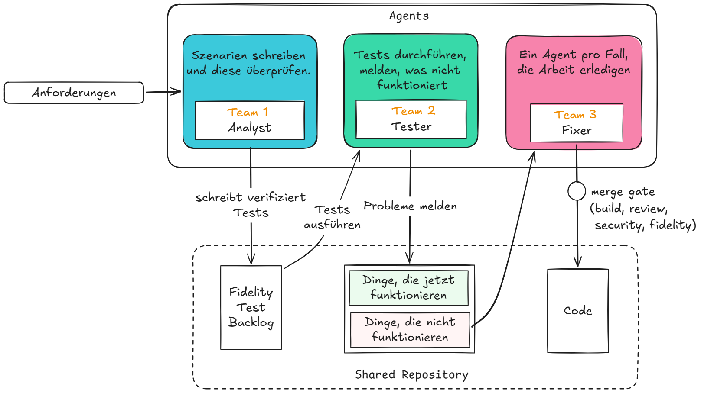

# KI in der Softwareentwicklung

*Stand: 15. November 2026.*

## Software entwickeln mit KI

KI lässt sich besonders wirkungsvoll einsetzen, wenn ihre Ergebnisse gut überprüfbar sind. In der Mathematik können etwa Beweise oder Gegenbeispiele eine Lösung bestätigen oder widerlegen. In der Softwareentwicklung helfen ausführbare Tests, festzustellen, ob eine Implementierung die erwarteten Ergebnisse liefert. Sie erfassen allerdings nur die geprüften Fälle und ersetzen keine vollständige fachliche Bewertung.

Damit verändert sich die Arbeit in der Softwareentwicklung: KI kann neben dem Schreiben von Code auch Tests erstellen, Fehler suchen und Korrekturen umsetzen. Für Menschen gewinnen klare Anforderungen, geeignete Prüfverfahren und die Gestaltung des gesamten Entwicklungsprozesses an Bedeutung. Je verlässlicher sich Ergebnisse prüfen lassen, desto mehr Arbeitsschritte können Agenten selbstständig übernehmen.

### Wie könnte eine Entwicklungspipeline mit KI aussehen?

Die folgende Grafik zeigt einen möglichen Ablauf mit drei Agententeams und einem gemeinsamen Repository:

1. **Tests aus Anforderungen ableiten:** Das erste Team formuliert typische Nutzungsszenarien und erstellt daraus Tests. Es prüft die erwarteten Ergebnisse an einem verlässlichen Referenzsystem. Die bestätigten Tests bilden einen gemeinsamen Testbestand.
2. **Abweichungen finden:** Das zweite Team führt diese Tests gegen die zu entwickelnde Software aus. Es dokumentiert Fehler und bündelt Abweichungen, die vermutlich dieselbe Ursache haben, zu bearbeitbaren Aufgaben.
3. **Probleme einzeln beheben:** Im dritten Team übernimmt jeder Agent einen konkreten Fall. Er untersucht die Ursache und passt den Code an, bis das Problem behoben ist.
4. **Änderungen kontrollieren:** Vor der Übernahme muss jede Änderung eine Qualitätsprüfung bestehen: Lässt sich die Software bauen? Entspricht der Code den Vorgaben? Bestehen Sicherheitsprüfungen und die Tests zum erwarteten Verhalten? Bei Mängeln geht die Änderung zur Korrektur zurück.
5. **Übernehmen und erneut prüfen:** Erfolgreich geprüfte Änderungen gelangen in den Hauptbranch. Behobene Probleme werden entsprechend markiert. Die Teams setzen den Kreislauf mit weiteren Tests, Fehleranalysen und Korrekturen fort.

## Guardrails

Guardrails sind Leitplanken für die Arbeit mit KI: Sie legen fest, was ein Agent tun soll, welche Grenzen gelten und wie seine Ergebnisse geprüft werden. Dazu gehören verständliche Arbeitsanweisungen ebenso wie technische Zugriffsbeschränkungen, Tests und Freigaben.

Für die Anwendung halten Sie dauerhafte Projektregeln in einer vom Werkzeug unterstützten Anweisungsdatei fest, etwa `AGENTS.md`. Darin stehen beispielsweise der Arbeitsablauf, erlaubte Änderungen und erforderliche Prüfungen. Kontrollieren Sie, ob das eingesetzte Werkzeug die Datei tatsächlich lädt. Verbindliche Grenzen setzen Sie zusätzlich technisch durch, etwa über eingeschränkte Schreibrechte oder geschützte Branches. Eine Anweisung allein garantiert nicht, dass der Agent sie einhält.

### Tipps für sinnvolle Guardrails

- **Wenige, klare Regeln formulieren:** Beschreiben Sie konkrete Handlungen mit erkennbarem Anlass. Statt „Teste gründlich“: „Führe vor der Übergabe die relevanten Tests aus der Projektanleitung aus und dokumentiere die Ergebnisse. Falls ein Test nicht ausführbar ist, benenne den Grund.“
- **Den Auftrag eingrenzen:** Legen Sie fest, welche Dateien und Aufgaben bearbeitet werden dürfen. Zusätzlich entdeckte Verbesserungen werden separat festgehalten.
- **Selbstständigkeit und Freigaben klären:** Vereinbaren Sie, welche Aktionen der Agent eigenständig ausführen darf und wann eine Freigabe erforderlich ist. Diese muss sich auf die konkrete Aktion, ihren Inhalt und ihr Ziel beziehen.
- **Berechtigungen begrenzen:** Geben Sie nur die benötigten Zugriffe auf Dateien, Dienste und Netzwerkziele frei. Halten Sie nicht benötigte Zugangsdaten aus dem Arbeitsbereich heraus und begrenzen Sie Laufzeit und Kosten.
- **Qualität vor der Übernahme prüfen:** Nutzen Sie verpflichtende Tests und ein unabhängiges Review. Nach weiteren Änderungen muss die betroffene Version erneut geprüft werden. Schutzmechanismen darf der Agent nicht eigenständig abschalten.
- **Fremde Inhalte als Arbeitsmaterial behandeln:** Anweisungen in Webseiten, Dokumenten oder fremdem Code erteilen dem Agenten keine zusätzlichen Befugnisse. Prüfen Sie fremde Regeldateien vor ihrer Übernahme.
- **Die Wirkung erproben:** Testen Sie normale Aufgaben, Grenzfälle und unerlaubte Aktionen in einer isolierten Umgebung mit künstlichen Geheimnissen. Prüfen Sie auch, ob Regeln unnötige Rückfragen verursachen, und wiederholen Sie die Prüfung nach Anpassungen.

## Wie umgehen mit der Flut an Änderungen und Findings von KI?

KI kann in kurzer Zeit viele Codeänderungen und vermeintliche Fehlerbefunde erzeugen. Dadurch verschiebt sich der Engpass: Die Umsetzung wird schneller, während die fachliche Bewertung und das Review mehr Aufmerksamkeit verlangen. Wenn jede Meldung ungefiltert bei Menschen landet, wächst der Prüfaufwand mit der Produktivität der Agenten.

Hinzu kommt, dass KI weiterhin plausible, aber falsche Aussagen liefern kann. Ein gemeldeter Fehler muss daher zunächst nachvollziehbar sein. Hilfreich sind klare Annahmekriterien für Findings: Wo tritt das Problem auf? Wie lässt es sich reproduzieren? Was wird erwartet, und was passiert tatsächlich? Ein ausführbarer Test kann den Befund stützen. Mehrere KI-Agenten, die derselben Aussage zustimmen, ersetzen diesen Nachweis nicht.

Ein geeigneter Prozess filtert und priorisiert, bevor ein menschliches Review beginnt. Doppelte Meldungen werden gebündelt, bereits widerlegte Befunde aussortiert und Auswirkungen bewertet. Änderungen bleiben klein genug, um sie gezielt prüfen zu können. Automatisierte Prüfungen übernehmen wiederkehrende Kontrollen; Menschen konzentrieren sich auf fachliche Richtigkeit, Architekturentscheidungen und Änderungen mit hoher Tragweite. Neue Tests müssen dabei selbst geprüft werden: Ein bestandener Test hilft wenig, wenn er das falsche Verhalten bestätigt.

Wie weit diese Automatisierung sinnvoll ist, hängt vom Anwendungsfall ab. Eine interne Hilfsfunktion verlangt andere Prüfungen als eine Änderung an Zahlungsabläufen oder Zugriffsrechten. Begrenzen Sie deshalb die gleichzeitig laufenden Aufgaben auf die verfügbare Prüfkapazität. Beobachten Sie neben der Zahl erledigter Aufgaben auch die Wartezeit im Review, Fehlalarme und später entdeckte Fehler. So lässt sich erkennen, ob KI den gesamten Prozess verbessert oder vor allem neue Warteschlangen erzeugt.
